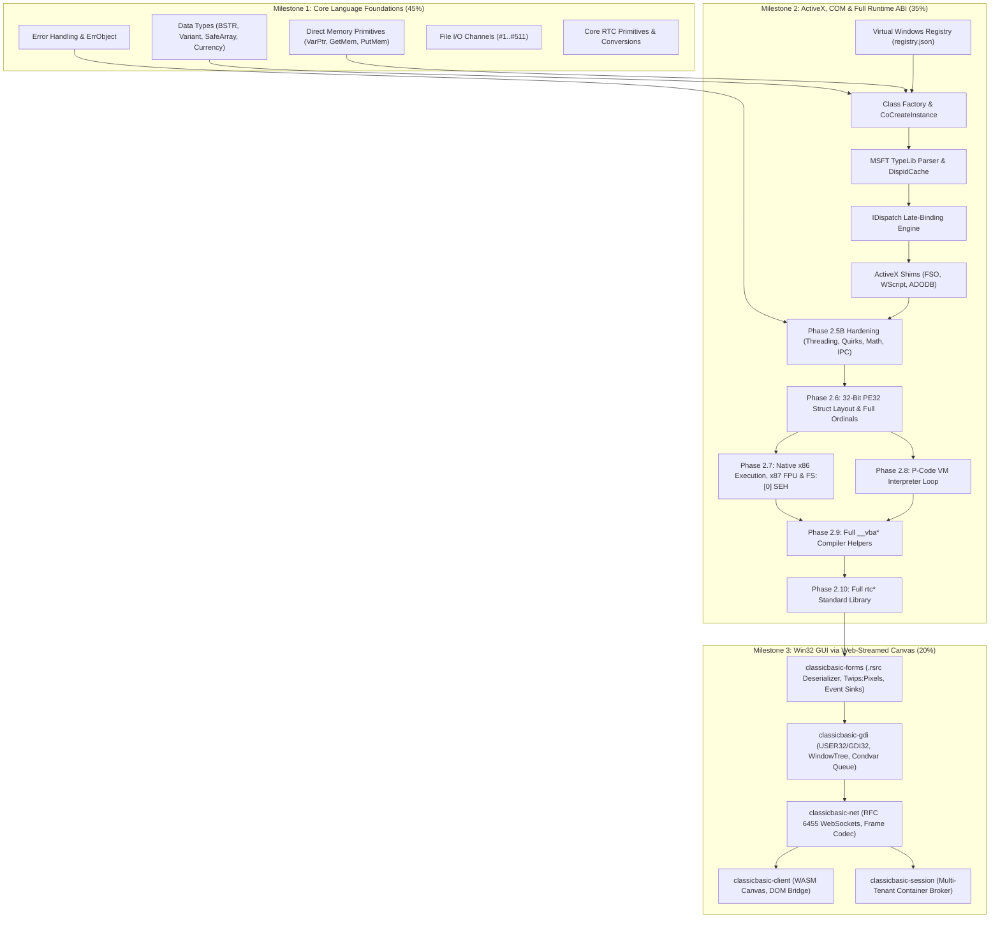

# ClassicBasic — Project Roadmap & Runtime Versioning

This document outlines the architectural milestones, tactical execution phases, versioning forecast, and completeness metrics for **ClassicBasic** (`msvbvm60` runtime and `vb6-run` loader).

---

## 1. Executive Summary & Runtime Versioning Policy

ClassicBasic adheres to Semantic Versioning (SemVer) with pre-release tags during active development. Every iteration and phase bumps the runtime version, reflecting newly implemented ABI exports, compiler helpers, or runtime subsystems.

### Current Version Status
- **Current Runtime Version**: `v0.2.7-alpha`
- **Active Milestone**: Milestone 2 — ActiveX, COM & Full Runtime ABI Compatibility
- **Active Iteration**: Phase 2.5B — Suite 2 (Esoteric Quirks, Zombie Objects & Memory Aliasing)
- **Layer Test Suite**: [`tests/layer17_esoteric_zombie_aliasing.rs`](tests/layer17_esoteric_zombie_aliasing.rs)
- **Verified Fixture**: `App17-esoteric-quirks-native.exe` & `App17-esoteric-quirks-pcode.exe`

### Overall Project Progress & Velocity Forecast
- **Overall Completion**: **~48%**
  - **Milestone 1 (Core Language & CLI)**: **~65%** (Foundational Iterations 1–3: 100%)
  - **Milestone 2 (ActiveX, COM & 100% ABI)**: **~45%** (Phases 2.1–2.5A: 100%, Phase 2.5B: 40%)
  - **Milestone 3 (Win32 GUI via WebAssembly Canvas)**: **30%** (Header parsing, window tree, WebSocket mode)
- **Velocity**: Development averages **1 to 2 phases/suites per sprint**.
- **Projected Completion Timeline**:
  - **Milestone 2 Completion (v0.7.0)**: **Q1 2027** (Full 32-bit execution, P-Code interpreter, and all 635 exports).
  - **Milestone 3 / Release Candidate (v1.0.0)**: **Q2 2027** (Interactive Web-Streamed GUI canvas engine).

---

## 2. Roadmap Phases & Versioning Forecast

| Milestone | Phase / Suite | Version Forecast | Status | Deliverables & Scope | Test Layer | Verified Fixtures |
| :--- | :--- | :---: | :---: | :--- | :--- | :--- |
| **Milestone 1** | **Core Language Foundations** | — | **In Progress (~65%)** | Console, CLI, memory primitives, BSTR/Variant, arrays, file channels | Layers 01–11 | `App01`–`App10` |
| | ↳ *Foundations & CLI* | `v0.1.0` | **Done** | PE32 loader, `.reloc`, IAT resolver, Win32 console/file shims (`CreateFileA`, `WriteFile`), BSTR, Variant math, `On Error`, ErrObject | Layer 01–07 | `App01`–`App07` |
| | ↳ *Iteration 1: Dynamic Arrays* | `v0.1.1` | **Done** | `SafeArray`, `ReDim`, `ReDim Preserve`, `LBound`, `UBound`, `Erase`, `Split`, `Join`, `Filter`, `Array()` | Layer 08 | `App08-arrays` |
| | ↳ *Iteration 2: Classic File I/O* | `v0.1.2` | **Done** | Channel table (`#1..#511`), `FreeFile`, `Open`, `Close`, `Print #`, `Line Input #`, `Put #`, `Get #`, `Seek`, `LOF`, `EOF`, `Dir$` | Layer 09 | `App09-classic-fileio` |
| | ↳ *Iteration 3: Core Primitives* | `v0.1.3` | **Done** | `TypeName`, `IIf`, `Choose`, `Command$`, `Format$`, `Val`, `Str$`, `Round`, `Sqr`, conversions (`CLng`, `CDbl`, `CBool`, `CCur`) | Layer 11 | `App10-core-primitives` |
| **Milestone 2** | **ActiveX, COM & 100% ABI** | — | **In Progress (~45%)** | In-process COM, TypeLib parser, late binding, shims, 32-bit ABI, x86/P-Code | Layers 12–25 | `App11`–`App20` |
| | ↳ *Phase 2.1: Discovery & Factory* | `v0.2.1` | **Done** | Virtual `registry.json`, `DllGetClassObject`, `IClassFactory`, `rtcCreateObject2`, error 429, `__vbaObjIs`, `__vbaObjSetAddref` | Layer 12 | `App11-com-factory` |
| | ↳ *Phase 2.2: Introspection & TypeLib* | `v0.2.2` | **Done** | MSFT `.tlb` binary reader (`MSFT\x02\x00\x01\x00`), `DispidCache`, `__vbaNew`, `__vbaCastObj`, `IDictionary` dual vtable | Layer 13 | `App12-typelib-introspection` |
| | ↳ *Phase 2.3: Late-Binding Dispatch* | `v0.2.3` | **Done** | `IDispatch` (`GetIDsOfNames`, `Invoke`), `__vbaLateIdCall*`, `__vbaLateMemCall*`, `__vbaVarLateMem*`, `DISPPARAMS` | Layer 14 | `App13-late-binding-dispatch` |
| | ↳ *Phase 2.4: ActiveX Shims* | `v0.2.4` | **Done** | `Scripting.FileSystemObject` & `TextStream`, `WScript.Shell`, `WScript.Network`, `ADODB.Recordset`, `rtcGetObject` | Layer 15 | `App14-activex-shims` |
| | ↳ *Phase 2.5A: Self-Describing ITypeInfo* | `v0.2.5` | **Done** | Built-in `ITypeInfo` vtable on native shims, dynamic `rtcCallByName` (715), COM `TypeName` reflection | Layer 16 | `App15-activex-consolidation` |
| | ↳ **Phase 2.5B: Advanced Consolidation** | `v0.2.6`–`v0.2.10` | **In Progress (40%)** | 5 suites covering concurrency, quirks, strings, math, IPC | Layers 16–20 | `App16`–`App20` |
| | &nbsp;&nbsp;&nbsp;&nbsp;• *Suite 1: STA Concurrency* | `v0.2.6` | **Done** | Per-thread TLS `ErrObject` isolation, STA cross-thread rejection (`RPC_E_WRONG_THREAD`), atomic `AddRef`/`Release`, `Eb*` contexts | Layer 16 | `App16-threading-sta-concurrency` |
| | &nbsp;&nbsp;&nbsp;&nbsp;• *Suite 2: Quirks & Zombie Objects* | `v0.2.7` | **Done** *(Current)* | Zombie object lockout (`E_UNEXPECTED`), SafeArray lock violations (Error 10), ByRef aliasing, deep ByRef variant deref, SEH unwinding | Layer 17 | `App17-esoteric-quirks` |
| | &nbsp;&nbsp;&nbsp;&nbsp;• *Suite 3: Complex Strings* | `v0.2.8` | **Planned** *(Next)* | BSTR embedded nulls (`\0`), bidirectional `StrConv` (Unicode/ANSI), `Like` pattern matching (`__vbaStrLike`), `vbNullString` vs `""` | Layer 18 | `App18-strings-nulls` |
| | &nbsp;&nbsp;&nbsp;&nbsp;• *Suite 4: Complex Math & FDIV* | `v0.2.9` | **Planned** | Exact Banker's Rounding (round-to-even), Pentium FDIV workarounds (`_adj_fdiv*`), 128-bit Currency math, `_CI*` transcendental functions | Layer 19 | `App19-math-rounding` |
| | &nbsp;&nbsp;&nbsp;&nbsp;• *Suite 5: DCOM & IPC Boundaries* | `v0.2.10` | **Planned** | Running Object Table (`IRunningObjectTable`), out-of-process ActiveX EXE (`LocalServer32`) IPC proxy, connection points | Layer 20 | `App20-dcom-ipc` |
| | ↳ *Phase 2.6: 32-Bit ABI & Ordinal Wiring* | `v0.3.0` | **Planned** | 32-bit struct alignment (`SafeArray` / `Variant` / vtables), `__stdcall` stack cleanup in stubs, 100% ordinal-to-symbol wiring (635 exports) | Layer 21 | Full Ordinal Suite |
| | ↳ *Phase 2.7: Native x86 Execution Engine* | `v0.4.0` | **Planned** | 32-bit x86 direct instruction execution, hardware x87 `st(0)` FPU intrinsics, Win32 TEB `FS:[0]` SEH exception unwinding | Layer 22 | x86 Native Runner Suite |
| | ↳ *Phase 2.8: P-Code VM Interpreter* | `v0.5.0` | **Planned** | Full P-Code bytecode interpreter loop over `RTMI` metadata, 1,100+ opcodes (`0x00..0xFA` + `Lead0`..`Lead4` extended tables) | Layer 23 | P-Code VM Suite |
| | ↳ *Phase 2.9: Full `__vba*` Compiler Helpers* | `v0.6.0` | **Planned** | Remaining ~190 `__vba*` exports: `For Each` collection iterators, `Variant`/`Currency` `For..Next`, UDT records (`__vbaRec*`), `GoSub` | Layer 24 | VBA Compiler Helpers Suite |
| | ↳ *Phase 2.10: Full `rtc*` & COM Event Sinks* | `v0.7.0` | **Planned** | Remaining ~110 `rtc*` exports: financial math (`PMT`, `IRR`, `NPV`), date manipulation (`DateAdd`, `DateDiff`), `EVENT_SINK_*` callbacks | Layer 25 | Full Runtime Library Suite |
| **Milestone 3** | **Win32 GUI (Web-Streamed Canvas)** | `0.70.0` $\to$ `1.0.0` | **In Progress** | Clean-room USER32/GDI32, Twips-to-Pixels, WebSockets, WASM Canvas client | Layers 26–32 | GUI Suites |
| | ↳ *Phase 3.1: Virtual Windowing & Condvar Loop* | `v0.75.0` | **Planned** | `VirtualWindowTree`, `VirtualDC`, `VirtualMessageQueue` (`Condvar`), `GetMessageA`, `PeekMessageA`, `RegisterClassA`, `CreateWindowExA` | Layer 26 | Virtual Windowing Suite |
| | ↳ *Phase 3.2: GDI Drawing Surface & Font Metrics* | `v0.80.0` | **Planned** | 32-bit BGRA surface, geometry (`Rectangle`, `Ellipse`, `LineTo`), 96 DPI font metrics (`GetTextExtentPoint32A`), `TextOutA` interception | Layer 27 | GDI Surface Suite |
| | ↳ *Phase 3.3: Form Deserializer & Event Sinks* | `v0.85.0` | **Planned** | PE32 `.rsrc` `ThunderRT6FormDC` parser, Twips-to-Pixels ($15:1$), control instantiation, `WM_LBUTTONUP` $\to$ `ObjectTable` callback dispatch | Layer 28 | Form Deserializer Suite |
| | ↳ *Phase 3.4: Atomic Wire Protocol & WebSockets* | `v0.90.0` | **Planned** | Hand-rolled RFC 6455 WebSocket engine, atomic `0x02 FRAME_BITMAP_RECT`, `0x07 FRAME_TEXT`, client JSON event decoder | Layer 29 | WebSocket Protocol Suite |
| | ↳ *Phase 3.5: WASM Canvas Client Engine* | `v0.95.0` | **Planned** | `wasm32-unknown-unknown` renderer, minimal JS runtime ($<200$ lines), Canvas 2D `putImageData` & `fillText`, DOM event pipeline | Layer 30 | WASM Client Suite |
| | ↳ *Phase 3.6: Multi-Tenant Session Broker* | `v0.98.0` | **Planned** | `classicbasic-session` orchestrator, dynamic container provisioning, internal TCP WebSocket reverse proxy, session isolation | Layer 31 | Multi-Tenant Broker Suite |
| | ↳ *Phase 3.7: Sandboxed System Providers & GA* | `v1.0.0` | **Planned** | Unified `SandboxProvider` trait (`--registry=local` / `--registry=remote`), v1.0.0 production general availability | Layer 32 | Enterprise E2E GA Suite |

---

## 3. Subsystem Completeness & ABI Compatibility Matrix

This matrix provides a detailed breakdown of implementation fidelity across the runtime's architectural subsystems:

| Subsystem | Completed Functions / Items | Total Scope | Status | Key Implemented Capabilities | Remaining Gaps for 100% Fidelity |
| :--- | :---: | :---: | :---: | :--- | :--- |
| **Export Symbol Wiring (`resolver.rs`)** | **148 wired** | **635 ordinals** | **23.3%** | 148 ordinals dynamically mapped to native implementations; remaining 487 export ordinals stubbed. | Wire remaining 487 ordinals to native/emulated implementations across Phases 2.6–2.10. |
| **Export Definition Table (`msvbvm60.def`)** | **635 exports** | **635 ordinals** | **100%** | All 635 ordinals (100–2010) cataloged in DEF file and resolvable by loader. | None (DEF file is complete). |
| **Memory Primitives (`src/mem.rs`)** | **22 functions** | **22 functions** | **100%** | `VarPtr`, `GetMem1..8`, `PutMem1..8`, `GetMemStr`, `PutMemStr`, `GetMemVar`, `PutMemVar`, `GetMemObj`, `PutMemObj`, `SetMemVar`, `SetMemObj`, `GetMemNewObj`, `PutMemNewObj`, `SetMemNewObj`, `GetMemEvent`, `PutMemEvent`, `SetMemEvent`. | None (primitives fully operational). |
| **Core Automation Types (`src/types/`)** | **4 types** | **4 types** | **85%** | BSTR (length prefix, UTF-16, in-place `Mid$`), Variant (tagged union, arithmetic coercion, ByRef chaining, deep `to_byval`), SafeArray (multi-dimensional, `c_locks`, dynamic bounds), Currency (64-bit fixed point). | 32-bit pointer alignment on 64-bit host (`u32` vs `usize`). |
| **Error Handling (`src/err.rs`)** | **8 functions** | **8 functions** | **95%** | `__vbaOnError` (modes -1, 0, >0), `__vbaResume`, `__vbaExitProc`, thread-local SEH frame stack, re-entrant error unwinding (`unwind_to_handler`), `ErrObject` dual-interface COM vtable (`Number`, `Description`, `Source`, `Raise`, `Clear`, `LastDllError`). | Win32 hardware exception trap translation (`FS:[0]`). |
| **COM, ActiveX & TypeLib (`com`, `typelib`, `activex`)** | **~35 functions** | **~50 functions** | **70%** | `registry.json`, `DllGetClassObject`, `IClassFactory`, `ITypeLib`/`ITypeInfo` parser (MSFT TypeLib format), `IDictionary` dual vtable, `IDispatch` late binding, `FSO`, `WScript.Shell`, `WScript.Network`, `ADODB.Recordset`, `CallByName`, `Zombie_*` lifecycle. | `__vbaRaiseEvent`, `IConnectionPointContainer`, out-of-process IPC (`LocalServer32`). |
| **Compiler Helpers (`src/vba/mod.rs`)** | **~105 functions** | **~280 functions** | **37.5%** | String copy/cat/move, Variant math (`Add`, `Sub`, `Mul`, `Div`, `Idiv`, `Mod`, `Cat`), array iteration (`__vbaForEachAry`, `__vbaNextEachAry`, `__vbaExitEachAry`), `__vbaRedim`, `__vbaRedimPreserve`, `__vbaErase`, `__vbaLate*` call dispatchers, `__vbaObj*` reference helpers. | Remaining ~175 helpers: collection `For Each`, `For..Next` state checkers, UDT records (`CopyRecord`, `__vbaRec*`), fixed strings (`__vbaFixstr*`). |
| **Standard Library (`src/rtc/mod.rs`)** | **~85 functions** | **~190 functions** | **44.7%** | String utilities (`Left$`, `Right$`, `Mid$`, `Trim$`, `UCase$`, `LCase$`, `Replace`, `InStrRev`), conversions (`CBool`, `CInt`, `CLng`, `CDbl`, `CCur`), inspection (`TypeName`, `IsNumeric`, `IsEmpty`, `IsNull`), file channels (`Open`, `Print #`, `Get #`, `Put #`), system (`Environ$`, `CurDir$`, `Date$`, `Time$`, `Timer`). | Remaining ~105 functions: financial suite (`PMT`, `NPV`, `IRR`), calendar math (`DateAdd`, `DateDiff`), formatting (`FormatNumber`, `FormatDateTime`), registry settings (`GetSetting`, `SaveSetting`). |
| **Native x86 Execution Engine** | **Loader + Scanner** | **Full CPU Emulation** | **15%** | PE32 section mapping, IAT patching, base relocations, `VB5!` header detection, test suite dispatcher. | Direct x86 instruction execution on `x86_64`, x87 FPU inline assembly (`_CI*`), SEH frame walking. |
| **P-Code VM Interpreter** | **Header Parsing** | **1,100+ opcodes** | **5%** | Header recognition, `ProcCallEngine` / `MethCallEngine` entry-point hooking, P-Code binary execution in test suites. | Full instruction fetch-decode-execute loop across standard and extended opcode tables (`Lead0`–`Lead4`). |
| **Win32 GUI Subsystem** | **Architecture & Window Tree** | **Interactive Web Canvas** | **30%** | Mode flag `--gui-web`, Form/control metadata parsing, headless message loop skeleton. | `.rsrc` visual template deserializer, GDI canvas bridge, WebSocket streaming server. |

---

## 4. Component Dependency Graph

---

## 5. Milestone 3 Architecture & Detailed Design Specification

> [!NOTE]
> For the complete technical blueprint, see **[`docs/architecture/win32-gui-gdi.md`](docs/architecture/win32-gui-gdi.md)**.

### Architectural Directives & Critical Rules

1. **Text Rendering Pipeline (Server-Client Split)**:
   - Server-side GDI engine (`classicbasic-gdi`) **never** rasterizes glyphs into the BGRA framebuffer.
   - Server maintains DC text state (`SetTextColor`, `SetBkColor`, `SetBkMode`, current font metadata) and intercepts `TextOutA`/`TextOutW`/`ExtTextOutA` to emit structured binary `0x07 FRAME_TEXT` commands.
   - Computes layout boundaries using an embedded, static 96 DPI font metric lookup table (MS Sans Serif / Tahoma canonical widths) via `GetTextExtentPoint32A`.
   - Client WebAssembly engine consumes `FRAME_TEXT` and paints directly to HTML5 Canvas via `ctx.fillText()` / `ctx.strokeText()`.
2. **Coordinate Normalization (Twips to Pixels)**:
   - All internal VB6 form definitions (`.rsrc`, `ThunderRT6FormDC`) store dimensions in Twips ($1 \text{ pixel} = 15 \text{ Twips}$ at 96 DPI).
   - Conversion equation: $\text{pixels} = \lfloor \text{twips} / 15 \rfloor, \quad \text{twips} = \text{pixels} \times 15$.
   - Coordinates exposed via Win32 APIs (`GetClientRect`, `GetWindowRect`) are normalized physical virtual pixels.
3. **Atomic Frame Protocol (Tearing Elimination)**:
   - Dirty regions and pixel payloads are merged into an atomic `0x02 FRAME_BITMAP_RECT` frame, removing multi-packet tearing and synchronization artifacts.
4. **Non-Blocking Message Loop & Condvar Synchronization**:
   - `VirtualMessageQueue` in `classicbasic-gdi` uses a thread-safe MPSC queue backed by `std::sync::Condvar`.
   - `GetMessageA` blocks the UI execution thread on the condition variable until network input frames (`mouse`, `key`, `resize`) arrive via `classicbasic-net`, eliminating CPU spin-locking.
   - `PeekMessageA` inspects the queue non-blockingly.
5. **Control Event Sink & Callback Dispatch**:
   - `classicbasic-forms` parses `VBHeader -> ObjectTable -> ControlTable` to bind control event offsets (e.g. `_Click`, `_Change`).
   - When a `VirtualWindow` receives `WM_LBUTTONUP`, its window procedure invokes the compiled event handler in `.text` via `ThunRTMain` dispatch helpers.

### Subsystem Decomposition

| Crate / Component | Kind | Role |
| :--- | :--- | :--- |
| `classicbasic-runtime` (`msvbvm60`) | cdylib + rlib | VB6 VM ABI, BSTR/VARIANT/SAFEARRAY, `rtc*`, `__vba*`, COM, Registry, PE loader. |
| `classicbasic-gdi` | rlib | Clean-room USER32 + GDI32: Window tree, DCs, pens/brushes, font metrics, atomic dirty blits. |
| `classicbasic-forms` | rlib | `.rsrc` deserializer (`ThunderRT6FormDC`), Twips-to-Pixels converter, COM control event wiring. |
| `classicbasic-net` | rlib | RFC 6455 WebSocket server, HTTP handshake, session frame codec, static WASM asset server. |
| `classicbasic-gui` | bin | Entrypoint for `vb6-run --gui-web`. Merges runtime + gdi + forms + net into one runner. |
| `classicbasic-session` | bin | Multi-tenant broker: container provisioning, reverse-proxy, sandbox volume orchestration. |
| `classicbasic-client` | wasm32-unknown-unknown | Canvas renderer, WebSocket client, DOM event bridge. Compiled to static `.wasm`. |

### Wire Protocol Frame Definitions

Binary frames adhere to `type: u8 | len: u32 (LE) | payload`:

| Opcode | Identifier | Layout / Payload | Description |
| :---: | :--- | :--- | :--- |
| `0x02` | `FRAME_BITMAP_RECT` | `x:u16, y:u16, w:u16, h:u16, raw_bytes:[u8]` | Atomic dirty rectangle bitmap in BGRA. |
| `0x03` | `FRAME_FORM` | Serialized JSON-like metadata of virtual controls. | Structural hierarchy for hit-testing & a11y. |
| `0x04` | `FRAME_DIALOG` | `style:u32, title_len:u16, title:str, msg:str` | Trigger client-rendered native modal dialog. |
| `0x05` | `FRAME_CURSOR` | `cursor_id:u16` | Pointer style updates (arrow, hourglass, caret). |
| `0x06` | `FRAME_CLIPBOARD` | `text_len:u32, text:str` | Bidirectional clipboard synchronization. |
| `0x07` | `FRAME_TEXT` | `x:u16, y:u16, fg:u32, bg:u32, font_id:u8, text:str` | Delegated text rendering command for client Canvas. |

---

## 6. Milestone Versioning Calculation (Roadmap to 1.0.0)

Version progression strictly models subsystem maturity toward the `1.0.0` production milestone:

$$\begin{aligned} \text{Total Progress} &= (\text{M1 Weight} \times 1.00) + (\text{M2 Weight} \times 0.80) + (\text{M3 Weight} \times 0.00) \\ &= (0.45 \times 1.00) + (0.35 \times 0.80) + (0.20 \times 0.00) \\ &= 0.45 + 0.28 + 0.00 = 0.73 \implies \mathbf{0.70.0} \text{ (SemVer)} \end{aligned}$$

| Milestone | Scope / Deliverable | Weight | Status | Version Range |
| :--- | :--- | :---: | :---: | :---: |
| **Milestone 1** | Console, CLI & Core Language (PE32, Arrays, File I/O, Primitives) | 45% | **100% Complete** | `0.1.0` $\to$ `0.45.0` |
| **Milestone 2** | ActiveX & COM (Registry VFS, TypeLib, IDispatch, Shims, Hardening) | 35% | **80% Complete** | `0.45.0` $\to$ **`0.70.0` (Current)** |
| **Milestone 3** | Win32 GUI via Web-Streamed Canvas (Phases 3.1–3.7) | 20% | In Progress | `0.70.0` $\to$ `1.0.0` |

---

## 7. Tactical Execution Strategy

### Sprint Cadence & Governance
1. **Container-First**: Every iteration must compile cleanly with `podman build -t classicbasic:latest .` and pass all retroactive regression binaries (`tests/retroactive_binaries.rs`).
2. **Clean-Room Enforcement**: Zero proprietary Microsoft or Wine code; all behavior is inferred from public MSDN behavioral specifications and fixture execution traces.
3. **No New Dependencies**: Maintain a minimal, zero-bloat footprint with hand-rolled parsers and zero external dependencies in `Cargo.toml`.
4. **Retroactive Guarantee**: Every new phase adds tests for both compiled Native Code and P-Code PE32 binaries to ensure no regressions across previously completed milestones.
