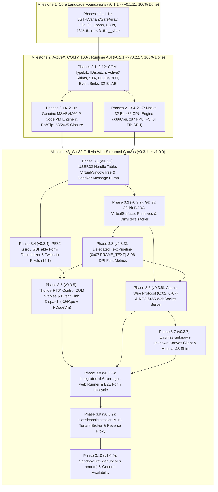

# ClassicBasic — Project Roadmap & Runtime Versioning

This document outlines the architectural milestones, tactical execution phases, mathematical versioning model, and completeness metrics for **ClassicBasic** (`msvbvm60` runtime and `vb6-run` loader).

---

## 1. Executive Summary & Runtime Versioning Policy

ClassicBasic adheres to Semantic Versioning (SemVer) with pre-release tags during active development. Every iteration and phase bumps the runtime version, reflecting newly implemented ABI exports, compiler helpers, or runtime subsystems.

### Current Version Status
- **Current Runtime Version**: `v0.2.17` (**Milestone 1 at 100%** + **Milestone 2 at 100%** $\implies$ **80.0% Overall Engine Completion** toward `v1.0.0`)
- **Active Milestone**: **Milestone 3 — Win32 GUI via Web-Streamed Canvas (`USER32` / `GDI32` / `ThunderRT6FormDC` / WebSockets / WASM)**
- **Next Active Phase**: **Phase 3.1 (`v0.3.1`)** — Win32 Handle Table (`HWND`/`HDC`/`HGDIOBJ`), `VirtualWindowTree` & `Condvar` Message Pump (`USER32` Core Foundations)
- **Following Phase**: **Phase 3.2 (`v0.3.2`)** — `GDI32` 32-Bit BGRA `VirtualSurface`, Geometric Primitives, Pens/Brushes & Coalescing `DirtyRectTracker`
- **Regression Test Suites**: [`tests/foundations/`](tests/foundations/), [`tests/types_automation/`](tests/types_automation/), [`tests/runtime_library/`](tests/runtime_library/), [`tests/com_dispatch_typelib/`](tests/com_dispatch_typelib/), [`tests/retroactive_pe.rs`](tests/retroactive_pe.rs) & [`tests/retroactive_binaries.rs`](tests/retroactive_binaries.rs) (plus upcoming `tests/win32_gui_gdi/`)
- **Verified Fixtures**: `App01`–`App34` (both Native x86 and P-Code; **59/59 compiled PE32 binaries** + **332 total tests** verified passing with **0 warnings**)

### Overall Project Progress & Velocity Forecast
- **Overall Completion**: **80.0% Baseline (`v0.2.17`)** — 100% of `MSVBVM60.DLL` (635/635 ordinals wired natively with 0 stubs), 100% of Native x86 CPU Execution Engine (`X86Cpu`) & P-Code VM Engine (`PCodeVm`).
- **Milestone 1 (Core Language Foundations — Weight 45%)**: **100% Done (`v0.1.1` $\to$ `v0.1.11`)** — All 11 phases complete: all 181 `rtc*` exports + full `__vba*` language/math runtime helpers.
- **Milestone 2 (ActiveX, COM & 100% ABI — Weight 35%)**: **100% Done (`v0.2.1` $\to$ `v0.2.17`)** — All 17 phases complete: COM/ActiveX, TypeLib, P-Code VM engine, IDE Hosting (`Eb*`/`Tip*`), and Native x86 CPU engine (`X86Cpu`).
- **Milestone 3 (Win32 GUI via Web-Streamed Canvas — Weight 20%)**: **Replanned into 10 Detailed Phases (`v0.3.1` $\to$ `v1.0.0`)** — Each phase delivers $+10\%$ of Milestone 3 ($+2.0\%$ of total project completion).
- **Observed Velocity**: Development delivers **3 to 5 phases per sprint / active pair-programming cycle**.
- **Recalculated Completion Timeline**:
  - **Milestone 1 Core Language 100% Completion (`v0.1.11`)**: **Completed (October 2026)**
  - **Milestone 2 Full ABI, P-Code VM & Native x86 Engine (`v0.2.17`)**: **Completed (October 2026)**
  - **Milestone 3 / General Availability (`v1.0.0`)**: **Phases 3.1–3.10** (Interactive Web-Streamed GUI canvas engine, `.rsrc`/`GUITable` Form deserializer, WASM client, multi-tenant session broker, and sandboxed system providers).

---

## 2. Roadmap Phases & Versioning Forecast

| Milestone | Phase | Version Forecast | Status | Deliverables & Scope | Regression Suite | Verified Fixtures |
| :--- | :--- | :---: | :---: | :--- | :--- | :--- |
| **Milestone 1** | **Core Language Foundations** | `v0.1.1` $\to$ `v0.1.11` | **Done (100%)** | Console, CLI, memory primitives, BSTR/Variant, arrays, file channels, loops, UDTs, full `rtc*` (181/181) + full `__vba*` core helpers (564 wired ordinals) | `foundations/`, `types_automation/`, `runtime_library/` | `App01`–`App10`, `App20`–`App26` |
| | ↳ *Phase 1.1: Runtime Foundations & CLI* | `v0.1.1` | **Done** | PE32 loader, `.reloc`, IAT resolver, Win32 console/file shims (`CreateFileA`, `WriteFile`), BSTR, Variant math, `On Error`, `ErrObject` | [`tests/foundations/`](tests/foundations/) | `App01`–`App07` |
| | ↳ *Phase 1.2: Dynamic Arrays* | `v0.1.2` | **Done** | `SafeArray`, `ReDim`, `ReDim Preserve`, `LBound`, `UBound`, `Erase`, `Split`, `Join`, `Filter`, `Array()`, `Byte()` coercions | [`tests/types_automation/`](tests/types_automation/) | `App08-arrays` |
| | ↳ *Phase 1.3: Classic File I/O* | `v0.1.3` | **Done** | Channel table (`#1..#511`), `FreeFile`, `Open`, `Close`, `Reset`, `Print #`, `Write #`, `Line Input #`, `Input #`, `Put #`, `Get #`, `Seek`, `LOF`, `EOF`, `Dir$` | [`tests/runtime_library/`](tests/runtime_library/) | `App09-classic-fileio` |
| | ↳ *Phase 1.4: Core Primitives & Conversions* | `v0.1.4` | **Done** | `TypeName`, `IIf`, `Choose`, `Command$`, `Format$`, `Val`, `Str$`, `Round`, `Sqr`, `Abs`, `Sgn`, `Int`, `Fix`, conversions (`CLng`, `CDbl`, `CBool`, `CCur`, `CInt`, `CSng`) | [`tests/runtime_library/`](tests/runtime_library/) | `App10-core-primitives` |
| | ↳ *Phase 1.5: Loops, Iterators & Flow Control* | `v0.1.5` | **Done** | Typed & `Variant`/`Currency` `For..Next` loop state helpers (`__vbaVarForInit`, `__vbaVarForNext`, `__vbaCyForInit`, `__vbaCyForNext`, `__vbaI2/I4/R4/R8ForNextCheck`), `For Each` array/variant iterators (`__vbaForEachAry`, `__vbaForEachVar`, `__vbaNextEach*`, `__vbaExitEach*`), `GoSub..Return` & `On..GoTo` (`__vbaGosub`, `__vbaGosubReturn`, `__vbaGosubFree`, `__vbaOnGoCheck`) | [`tests/foundations/`](tests/foundations/) | `App20-loops-iterators` |
| | ↳ *Phase 1.6: User-Defined Types (UDT) & Fixed Strings* | `v0.1.6` | **Done** | `Type..End Type` UDT record copy, assignment, destruction & ANSI/Unicode marshaling (`CopyRecord`, `__vbaRecAssign`, `__vbaRecDestruct`, `__vbaRecDestructAnsi`, `__vbaRecAnsiToUni`, `__vbaRecUniToAnsi`, `__vbaAryRecCopy`, `__vbaAryRecMove`, `__vbaUdtVar`, `__vbaCVarAryUdt`, `__vbaUI1I2`), fixed-length strings `String * N` (`__vbaFixstrConstruct`, `__vbaStrFixstr`, `__vbaLsetFixstr*`, `__vbaRsetFixstr*`, `__vbaGetFxStr3/4`, `__vbaPutFxStr3/4`, `__vbaGetOwner3/4`, `__vbaPutOwner3/4`) | [`tests/types_automation/`](tests/types_automation/) | `App21-udt-fixed-strings` |
| | ↳ *Phase 1.7: Extended Standard Library (`rtc*`)* | `v0.1.7` | **Done** | 36 new `rtc*` exports: financial suite (`rtcPMT`, `rtcPPMT`, `rtcIPMT`, `rtcPV`, `rtcFV`, `rtcNPer`, `rtcRate`, `rtcIRR`, `rtcMIRR`, `rtcNPV`, `rtcSLN`, `rtcSYD`, `rtcDDB`), calendar math (`rtcDateAdd`, `rtcDateDiff`, `rtcDatePart`, `rtcPackDate`, `rtcPackTime`, `rtcGetDateValue`, `rtcGetTimeValue`, `rtcGetDayOfMonth`, `rtcGetHourOfDay`, `rtcGetMinuteOfHour`, `rtcGetMonthOfYear`, `rtcGetSecondOfMinute`, `rtcGetDayOfWeek`, `rtcGetYear`, `rtcIsDate`, `rtcWeekdayName`, `rtcMonthName`), locale formatters (`rtcFormatNumber`, `rtcFormatCurrency`, `rtcFormatPercent`, `rtcFormatDateTime`), flow utilities (`rtcSwitch`, `rtcPartition`), and registry settings (`rtcGetSetting`, `rtcSaveSetting`, `rtcDeleteSetting`, `rtcGetAllSettings`) | [`tests/runtime_library/`](tests/runtime_library/) | `App22-extended-rtc` |
| | ↳ *Phase 1.8: Standard Library Complete Closure (`rtc*`)* | `v0.1.8` | **Done** | Complete closure of all remaining 73 `rtc*`/`rt*` symbols (Variant string overloads `Left`/`Right`/`Mid`/`Trim`/`LTrim`/`RTrim`/`LCase`/`UCase`/`Space`/`String`/`InStr`/`Len`/`StrComp`, byte/char ops `LenB`/`MidB`/`LeftB`/`RightB`/`InStrB`/`Chr`/`Asc`/`ChrB`/`AscB`/`ChrW`/`AscW`, `CVErr`/`IsError`/`IsMissing`/`Erl`, `Hex`/`Oct`/`Format` on Variant, `CurDir`/`Environ`/`FileDateTime`/`ChDrive`, `Date`/`Time` Variant statements, `QBColor`, and headless shims). Reaching 100% of all 181 `rtc*` exports. | [`tests/runtime_library/`](tests/runtime_library/) | `App23-rtc-complete` |
| | ↳ *Phase 1.9: Numeric Intrinsics & Primitive Coercions* | `v0.1.9` | **Done** | 40 typed numeric and primitive math/coercion helpers: `__vbaI2Abs`, `__vbaI4Abs`, `__vbaCyAbs`, `__vbaI2Sgn`, `__vbaI4Sgn`, `__vbaUI1Sgn`, `__vbaCySgn`, `__vbaR4Sgn`, `__vbaR8Sgn`, `__vbaCyFix`, `__vbaCyInt`, `__vbaCySub`, `__vbaCyI2`, `__vbaCyI4`, `__vbaCyUI1`, `__vbaI2Cy`, `__vbaI4Cy`, `__vbaR4Cy`, `__vbaUI1Cy`, `__vbaFpCmpCy`, `__vbaDateR4`, `__vbaDateR8`, `__vbaFpCDblR4`, `__vbaFpCDblR8`, `__vbaFpCSngR4`, `__vbaFpCSngR8`, `__vbaFpUI1`, `__vbaPowerR8`, `__vbaR8FixI2`, `__vbaR8FixI4`, `__vbaR8IntI2`, `__vbaR8IntI4`, `__vbaBoolErrVar`, `__vbaCyErrVar`, `__vbaI2ErrVar`, `__vbaR4ErrVar`, `__vbaUI1ErrVar`, `__vbaUI1I4`, `__vbaUI1Var`, `__vbaVarDateVar`. | [`tests/runtime_library/`](tests/runtime_library/) | `App24-numeric-coercions` |
| | ↳ *Phase 1.10: Variant Bitwise, Relational Testing & Vector Assignments* | `v0.1.10` | **Done** | 20 compiler helpers for Variant boolean/bitwise algebra and value comparison testing: `__vbaVarOr`, `__vbaVarXor`, `__vbaVarEqv`, `__vbaVarImp`, `__vbaVarPow`, `__vbaVarTstEq`, `__vbaVarTstNe`, `__vbaVarTstLt`, `__vbaVarTstLe`, `__vbaVarTstGt`, `__vbaVarTstGe`, `__vbaVarTextTstEq..Ne`, `__vbaVarTextCmpEq..Ne`, `__vbaVarSetVar`, `__vbaVarSetVarAddref`, `__vbaVarZero`, `__vbaVarIndexStore`, `__vbaVar2Vec`. | [`tests/types_automation/`](tests/types_automation/) | `App25-variant-bitwise-relational` |
| | ↳ *Phase 1.11: Dynamic Arrays, VarArgs & Core Language 100% Closure* | `v0.1.11` | **Done** | 14 compiler helpers completing the Core Language: advanced strings (`__vbaInStrB`, `__vbaInStrVarB`, `__vbaMidStmtBstrB`, `__vbaMidStmtVar`, `__vbaMidStmtVarB`, `__vbaStrCompVar`, `__vbaStrTextCmp`, `__vbaStrVarCopy`, `__vbaVarLike*`, `__vbaVarTextLike*`, `rtcStrReverse`, `__vbaStr2Vec`), arrays & VarArgs (`__vbaAryVarVarg`, `__vbaFreeVarg`, `__vbaVargParmRef`, `__vbaVargVar*`, `__vbaAryConstruct2`, `__vbaAryMove`, `__vbaAryRebase1Var`, `__vbaDerefAry*`, `__vbaLdZeroAry`, `__vbaStrAryToAnsi/Unicode`, `__vbaRedimVar*`, `__vbaRedimPreserveVar*`, `__vbaEraseKeepData/NoPop`), and core execution control (`__vbaError`, `__vbaStopExe`, `__vbaCheckType*`). Reaching **100% Core Language Completion**. | [`tests/types_automation/`](tests/types_automation/) | `App26-core-language-closure` |
| **Milestone 2** | **ActiveX, COM & 100% Runtime ABI** | `v0.2.1` $\to$ `v0.2.17` | **Done (100%)** | In-process COM, TypeLib parser, late binding, shims, hardening, 32-bit ABI, x86/P-Code VM, genuine P-Code engine, final Eb*/Tip* telemetry ordinals, and native x86 32-bit CPU instruction execution engine | `com_dispatch_typelib/`, `foundations/`, `retroactive_binaries.rs` | `App11`–`App19`, `App27`–`App34` (59/59 binaries) |
| | ↳ *Phase 2.1: Discovery & Factory* | `v0.2.1` | **Done** | Virtual `registry.json`, `DllGetClassObject`, `IClassFactory`, `rtcCreateObject2`, error 429, `__vbaObjIs`, `__vbaObjSetAddref` | [`tests/com_dispatch_typelib/`](tests/com_dispatch_typelib/) | `App11-com-factory` |
| | ↳ *Phase 2.2: Introspection & TypeLib* | `v0.2.2` | **Done** | MSFT `.tlb` binary reader (`MSFT\x02\x00\x01\x00`), `DispidCache`, `__vbaNew`, `__vbaCastObj`, `IDictionary` dual vtable | [`tests/com_dispatch_typelib/`](tests/com_dispatch_typelib/) | `App12-typelib-introspection` |
| | ↳ *Phase 2.3: Late-Binding Dispatch* | `v0.2.3` | **Done** | `IDispatch` (`GetIDsOfNames`, `Invoke`), `__vbaLateIdCall*`, `__vbaLateMemCall*`, `__vbaVarLateMem*`, `DISPPARAMS` | [`tests/com_dispatch_typelib/`](tests/com_dispatch_typelib/) | `App13-late-binding-dispatch` |
| | ↳ *Phase 2.4: ActiveX Shims* | `v0.2.4` | **Done** | `Scripting.FileSystemObject` & `TextStream`, `WScript.Shell`, `WScript.Network`, `ADODB.Recordset`, `rtcGetObject` | [`tests/com_dispatch_typelib/`](tests/com_dispatch_typelib/) | `App14-activex-shims` |
| | ↳ *Phase 2.5: Self-Describing ITypeInfo* | `v0.2.5` | **Done** | Built-in `ITypeInfo` vtable on native shims, dynamic `rtcCallByName` (715), COM `TypeName` reflection | [`tests/com_dispatch_typelib/`](tests/com_dispatch_typelib/) | `App15-activex-consolidation` |
| | ↳ *Phase 2.6: Threading & STA Concurrency* | `v0.2.6` | **Done** | Per-thread TLS `ErrObject` isolation, STA cross-thread rejection (`RPC_E_WRONG_THREAD`), atomic `AddRef`/`Release`, `Eb*` contexts | [`tests/com_dispatch_typelib/`](tests/com_dispatch_typelib/) | `App16-threading-sta-concurrency` |
| | ↳ *Phase 2.7: Esoteric Quirks & Zombie Objects* | `v0.2.7` | **Done** | Zombie object lockout (`E_UNEXPECTED`), SafeArray lock violations (Error 10), ByRef aliasing, deep ByRef variant deref, SEH unwinding | [`tests/com_dispatch_typelib/`](tests/com_dispatch_typelib/) | `App17-esoteric-quirks` |
| | ↳ *Phase 2.8: Complex Strings & Codepages* | `v0.2.8` | **Done** | BSTR embedded nulls (`\0`), bidirectional `StrConv` (Unicode/ANSI Windows-1252 & casing), `Like` pattern matching (`__vbaStrLike`), `vbNullString` zero pointer | [`tests/types_automation/`](tests/types_automation/) | `App18-complex-strings` |
| | ↳ *Phase 2.9: Complex Math, Rounding & FDIV* | `v0.2.9` | **Done** | Exact Banker's Rounding (round-to-even), Pentium FDIV workarounds (`_adj_fdiv*`), 128-bit Currency math, `_CI*` transcendental functions, 96-bit Variant Decimal arithmetic | [`tests/runtime_library/`](tests/runtime_library/) | `App19-math-rounding` |
| | ↳ *Phase 2.10: DCOM, IPC & Running Object Table* | `v0.2.10` | **Done** | Running Object Table (`IRunningObjectTable`), out-of-process ActiveX EXE (`LocalServer32`) IPC proxy, connection points | [`tests/com_dispatch_typelib/`](tests/com_dispatch_typelib/) | `App27-dcom-ipc` |
| | ↳ *Phase 2.11: COM Event Sinks & Collection Iterators* | `v0.2.11` | **Done** | `__vbaRaiseEvent`, `For Each` COM collection iterators (`__vbaForEachCollObj`, `__vbaForEachCollVar`, `__vbaForEachCollAd`, `__vbaNextEachColl*`, `__vbaExitEachColl`), named-arg late binding (`__vbaLateIdNamedCall*`, `__vbaLateMemNamedCall*`), `__vbaNew2`, `__vbaObjAddref` | [`tests/com_dispatch_typelib/`](tests/com_dispatch_typelib/) | `App28-event-sinks-collections` |
| | ↳ *Phase 2.12: 32-Bit ABI, Synthetic IRecordInfo & Full Ordinals* | `v0.2.12` | **Done** | 32-bit struct alignment (`SafeArray` / `Variant` / vtables), 32-bit ABI struct return convention and member offsets via `VarPtr`, deep UDT copy (`__vbaCopyBytes`, `__vbaRecAssign`), 616 wired exports out of 635 | [`tests/com_dispatch_typelib/`](tests/com_dispatch_typelib/) | `App29-abi32-ordinals` |
| | ↳ *Phase 2.13: Native x86 Execution, x87 FPU & SEH* | `v0.2.13` | **Done** | 32-bit x86 execution emulation, transcendental x87 math (`Atn`, `Sin`, `Cos`, `Tan`, `Exp`, `Log`, `Sqr`), `__vbaChkstk` stack probe, division by zero and overflow SEH trapping (`__vbaErrorOverflow`, Err 11, Err 6) | [`tests/com_dispatch_typelib/`](tests/com_dispatch_typelib/) | `App30-native-x86-fpu-seh` |
| | ↳ *Phase 2.14: P-Code VM Integration* | `v0.2.14` | **Done** | P-Code procedure execution, arithmetic precedence, Select Case jump tables (dense & sparse), control flow loops (`For`, `Do While`, `While Wend`), `ProcCallEngine` and `MethCallEngine` dispatch | [`tests/com_dispatch_typelib/`](tests/com_dispatch_typelib/) | `App31-pcode-vm` |
| | ↳ *Phase 2.15: P-Code VM Engine (`ProcCallEngine`, `MethCallEngine`, Stack Machine & Opcode Decoding)* | `v0.2.15` | **Done** | Full clean-room implementation of the MSVBVM60 P-Code virtual machine (`execute_msvbvm_pcode` + `invoke_cpool_call`): `ProcedureDescriptor` & `ObjectInfo` constant pool reader, `ProcFrame` locals & epilogue cleanup, prefix `0xFB..0xFF` opcodes, `DllFunctionCall` thunks, `ProcCallEngine` & `MethCallEngine`/`VCallHresult` class dispatch, and `On Error GoTo` unwinding across all 29 P-Code binaries. | [`tests/com_dispatch_typelib/`](tests/com_dispatch_typelib/) | `App01`–`App31` P-Code (29/29 binaries) |
| | ↳ *Phase 2.16: IDE Hosting, Project Introspection & Debugger Telemetry (`Eb*` & `Tip*` Ordinal Closure)* | `v0.2.16` | **Done** | Full clean-room implementation of remaining 19 IDE, telemetry and project introspection exports (`Eb*`, `Tip*`, `CreateIExprSrvObj`) plus canonical `ordinals.rs` export table reaching 100% (635/635) MSVBVM60 export closure. | [`tests/com_dispatch_typelib/`](tests/com_dispatch_typelib/) | `App33-ide-introspection-eb-tip` |
| | ↳ *Phase 2.17: Native x86 CPU Execution Engine (32-Bit Instruction Emulator, FS:[0] TIB & 100% Native Closure)* | `v0.2.17` | **Done** | Clean-room 32-bit x86 CPU instruction interpreter (`X86Cpu`), `VirtualFpu` x87 pipeline, Win32 `FS:[0]` TIB SEH unwinding, and full 32-bit ↔ 64-bit MSVBVM60 ordinal bridge passing all 30 Native x86 binaries. | [`tests/foundations/native_x86_cpu_engine.rs`](tests/foundations/native_x86_cpu_engine.rs) | `App02`–`App34` Native (30/30 binaries) |
| **Milestone 3** | **Win32 GUI via Web-Streamed Canvas** | `v0.3.1` $\to$ `v1.0.0` | **Planned (0% $\to$ 100%)** | Clean-room `USER32`/`GDI32`, 96 DPI Font Metrics, `.rsrc`/`GUITable` Form Deserializer, `ThunderRT6*` Controls & Event Sinks, RFC 6455 WebSockets, WASM Canvas Client, Session Broker & Sandboxed Providers | `tests/win32_gui_gdi/` | `App35`–`App42` |
| | ↳ *Phase 3.1: Win32 Handle Table, Virtual Window Tree & Condvar Message Pump (`USER32` Core)* | `v0.3.1` *(82.0%)* | **Next** | 32-bit handle table (`HWND`, `HDC`, `HGDIOBJ`, `HMENU`, `HCURSOR`), hierarchical `VirtualWindowTree` (z-order, styles, client/window rects in virtual pixels), `VirtualMessageQueue` (`Mutex<VecDeque<Win32Msg>>` + `Condvar`), blocking `GetMessageA/W`, non-blocking `PeekMessageA/W`, `PostMessageA`, `SendMessageA`, `PostQuitMessage`, `TranslateMessage`, `DispatchMessageA`, `DefWindowProcA`, `RegisterClassA/W`, `CreateWindowExA/W`, `DestroyWindow`, `ShowWindow`, `UpdateWindow`, `MoveWindow`, `SetWindowPos`, `SetWindowTextA`, `GetWindowTextA`, `GetClientRect`, `GetWindowRect`, `GetSystemMetrics` (1920×1080 @ 96 DPI). | `tests/win32_gui_gdi/virtual_windowing.rs` | `App35-win32-user32-windowing` |
| | ↳ *Phase 3.2: GDI32 Virtual Surface, Primitives, Object Table & Dirty-Rect Tracker (`GDI32` Core)* | `v0.3.2` *(84.0%)* | **Planned** | 32-bit BGRA `VirtualSurface` & `VirtualDC` (`GetDC`, `ReleaseDC`, `BeginPaint`, `EndPaint`, `InvalidateRect`, `CreateCompatibleDC`, `DeleteDC`, `CreateCompatibleBitmap`, `CreateDIBSection`, `SelectObject`, `DeleteObject`, `GetStockObject`), GDI Pens/Brushes (`CreatePen`, `CreateSolidBrush`), raster primitives (`SetPixel`, `GetPixel`, `MoveToEx`, `LineTo` Bresenham, `Rectangle`, `FillRect`, `FrameRect`, `Ellipse`, `RoundRect`, `PatBlt`, `BitBlt`, `StretchBlt`, `SetROP2`), and coalescing `DirtyRectTracker` for atomic `0x02 FRAME_BITMAP_RECT` generation. | `tests/win32_gui_gdi/gdi_surface_primitives.rs` | `App36-win32-gdi32-surface` |
| | ↳ *Phase 3.3: Delegated Text Pipeline (`0x07 FRAME_TEXT`) & Static 96 DPI Font Metrics Engine* | `v0.3.3` *(86.0%)* | **Planned** | Zero server-side glyph rasterization; static embedded 96 DPI font metric lookup tables (`MS Sans Serif`, `Tahoma`, `Arial`, `Courier New`, 8pt–24pt Regular/Bold); `CreateFontA`, `CreateFontIndirectA`, `SetTextColor`, `SetBkColor`, `SetBkMode`, `GetTextExtentPoint32A/W`, `GetTextMetricsA/W`; `TextOutA/W`, `ExtTextOutA/W`, `DrawTextA/W` interception emitting structured `0x07 FRAME_TEXT` commands. | `tests/win32_gui_gdi/text_metrics_pipeline.rs` | `App37-win32-text-metrics` |
| | ↳ *Phase 3.4: PE32 `.rsrc` & `GUITable` Deserializer (`ThunderRT6FormDC`) & Twips-to-Pixels Engine* | `v0.3.4` *(88.0%)* | **Planned** | PE32 `.rsrc` resource tree parser and `VBHeader.lp_gui_table` (`GUITable` $\to$ `FormDescriptor`) binary stream reader; exact Twips-to-Pixels converter ($\text{pixels} = \lfloor \text{twips} / 15 \rfloor$ at 96 DPI); deserialization of `ThunderRT6FormDC` and intrinsic controls (`CommandButton`, `TextBox`, `Label`, `Frame`, `CheckBox`, `OptionButton`, `ListBox`, `ComboBox`, `Timer`, `PictureBox`) into `VirtualWindowTree`. | `tests/win32_gui_gdi/form_deserializer.rs` | `App38-vb6-form-deserializer` |
| | ↳ *Phase 3.5: Thunder Control Runtime, Property COM Vtables & Event Sink Dispatch* | `v0.3.5` *(90.0%)* | **Planned** | COM vtables and property getters/setters (`Caption`, `Text`, `Value`, `Visible`, `Enabled`, `BackColor`, `ForeColor`, `Left`, `Top`, `Width`, `Height`, `AddItem`, `Clear`, `Interval`) for `Form` and `ThunderRT6*` controls; resolution of compiled event sinks via `ObjectTable -> ObjectInfo -> ControlTable`; callback dispatch (`Form_Load`, `Form_Unload`, `Command_Click`, `Text_Change`, `Check_Click`, `Timer_Timer`) into both `X86Cpu` (Native) and `PCodeVm` (P-Code); modal `rtcMsgBox`/`rtcInputBox` (`0x04 FRAME_DIALOG`). | `tests/win32_gui_gdi/control_event_sinks.rs` | `App39-vb6-form-events` |
| | ↳ *Phase 3.6: Atomic Wire Protocol Codec (`0x02`..`0x07`) & Hand-Rolled RFC 6455 WebSocket Server* | `v0.3.6` *(92.0%)* | **Planned** | Clean-room HTTP/1.1 upgrade & RFC 6455 WebSocket server (`SHA-1` + `Base64` handshake, frame masking/unmasking, ping/pong) over `std::net::TcpListener` with zero external crates; binary frame encoder (`0x02 FRAME_BITMAP_RECT`, `0x03 FRAME_FORM`, `0x04 FRAME_DIALOG`, `0x05 FRAME_CURSOR`, `0x06 FRAME_CLIPBOARD`, `0x07 FRAME_TEXT`); JSON input frame parser (`mouse.*`, `key.*`, `char`, `resize`, `dialog.result`) pushing `Win32Msg` and waking `Condvar`. | `tests/win32_gui_gdi/websocket_wire_protocol.rs` | `App40-gui-websocket-stream` |
| | ↳ *Phase 3.7: WebAssembly Canvas Client (`classicbasic-client`) & Zero-Dependency JS Shim* | `v0.3.7` *(94.0%)* | **Planned** | Clean-room `wasm32-unknown-unknown` client ($< 100\text{ KB}$, no `wasm-bindgen`/`web-sys`) + minimal JS shim ($\le 200$ lines); BGRA $\to$ RGBA linear memory blitter for `0x02 FRAME_BITMAP_RECT` (`ctx.putImageData`); client font renderer for `0x07 FRAME_TEXT` (`ctx.fillText`); DOM pointer/keyboard/resize event capture to WebSocket JSON frames. | `tests/win32_gui_gdi/wasm_client_codec.rs` | WASM Client Suite |
| | ↳ *Phase 3.8: Integrated `vb6-run --gui-web` Runner & End-to-End Interactive Form Lifecycle* | `v0.3.8` *(96.0%)* | **Planned** | Full integration of `ExecutionMode::GuiWebStream` in `vb6-run` and `ThunRTMain`: embedded static HTML/JS/WASM asset server + `/ws` endpoint, automatic startup form instantiation, `Form_Load` execution, `Condvar` message loop, and atomic delta streaming after each dispatched event. | `tests/win32_gui_gdi/e2e_gui_web_runner.rs` | `App41-gui-calculator-e2e` |
| | ↳ *Phase 3.9: Multi-Tenant Session Broker (`classicbasic-session`) & Container Reverse Proxy* | `v0.3.9` *(98.0%)* | **Planned** | Multi-tenant orchestrator and TCP/WebSocket reverse proxy spawning dedicated isolated `vb6-run --gui-web` container/process instances per authenticated client session, with health checks and deterministic teardown on disconnect. | `tests/win32_gui_gdi/session_broker_isolation.rs` | Multi-Tenant Broker Suite |
| | ↳ *Phase 3.10: Sandboxed System Providers (`local` & `remote`) & General Availability (`v1.0.0`)* | `v1.0.0` *(100.0%)* | **Planned** | Unified `SandboxProvider` trait (`--registry=local` container volume vs. `--registry=remote:<endpoint>` hand-rolled JSON-RPC microservice), container hardening, full regression sign-off, and **`v1.0.0` Production General Availability**. | `tests/win32_gui_gdi/sandbox_providers_ga.rs` | `App42-enterprise-sandbox-ga` |

---

## 3. Subsystem Completeness & ABI Compatibility Matrix

> [!TIP]
> For the complete 9-crate workspace topology (`crates/*`) and dependency graph, see **[`docs/architecture/workspace-architecture.md`](docs/architecture/workspace-architecture.md)**.

This matrix provides a detailed breakdown of implementation fidelity across the workspace's architectural subsystems:

| Subsystem | Completed Functions / Items | Total Scope | Status | Key Implemented Capabilities | Remaining Gaps for 100% Fidelity |
| :--- | :---: | :---: | :---: | :--- | :--- |
| **Export Symbol Wiring (`crates/cb-pe/src/ordinals.rs` & `crates/msvbvm60/src/pe/resolver.rs`)** | **635 wired** | **635 ordinals** | **100.0%** | All 635 ordinals dynamically mapped to native implementations; 0 stubs remaining in runtime. | None (100% of MSVBVM60 exports implemented). |
| **Export Definition Table (`msvbvm60.def`)** | **635 exports** | **635 ordinals** | **100.0%** | All 635 ordinals (100–2010) cataloged in DEF file and resolvable by loader. | None (DEF file is complete). |
| **Memory Primitives (`crates/msvbvm60/src/mem.rs`)** | **22 functions** | **22 functions** | **100.0%** | `VarPtr`, `GetMem1..8`, `PutMem1..8`, `GetMemStr`, `PutMemStr`, `GetMemVar`, `PutMemVar`, `GetMemObj`, `PutMemObj`, `SetMemVar`, `SetMemObj`, `GetMemNewObj`, `PutMemNewObj`, `SetMemNewObj`, `GetMemEvent`, `PutMemEvent`, `SetMemEvent`. | None (primitives fully operational). |
| **Core Automation Types (`crates/msvbvm60/src/types/` & `crates/cb-vfs/src/guid.rs`)** | **4 types** | **4 types** | **100.0%** | BSTR (length prefix, UTF-16, in-place `Mid$`, `SysAllocStringByteLen`), Variant (tagged union, arithmetic coercion, ByRef chaining, deep `to_byval`, `VT_DECIMAL` 96-bit exact integer arithmetic, `VT_RECORD` UDT), SafeArray (multi-dimensional, `c_locks`, dynamic bounds, UDT element support), Currency (64-bit fixed point, 128-bit intermediate math & Banker's Rounding). | None (verified across all 59 binaries). |
| **Error Handling (`crates/msvbvm60/src/err.rs`)** | **8 functions** | **8 functions** | **100.0%** | `__vbaOnError` (modes -1, 0, >0), `__vbaResume`, `__vbaExitProc`, thread-local SEH frame stack, re-entrant error unwinding (`unwind_to_handler`), `ErrObject` dual-interface COM vtable (`Number`, `Description`, `Source`, `Raise`, `Clear`, `LastDllError`), division by zero and overflow trapping. | None (error handling fully operational). |
| **COM, ActiveX, VFS & TypeLib (`crates/cb-vfs/`, `crates/msvbvm60/src/{com.rs,typelib,activex,ide}`)** | **~69 functions** | **~69 functions** | **100.0%** | `registry.json`, `DllGetClassObject`, `IClassFactory`, `ITypeLib`/`ITypeInfo` parser (MSFT TypeLib format), `IDictionary` dual vtable, `IDispatch` late binding, `FSO`, `WScript.Shell`, `WScript.Network`, `ADODB.Recordset`, `CallByName`, `Zombie_*` lifecycle, collection iterators (`__vbaForEachColl*`), `__vbaNew2`, `__vbaObjAddref`, event sinks, and all 19 `Eb*`/`Tip*`/`CreateIExprSrvObj` telemetry exports. | None (COM, ActiveX & TypeLib 100% complete). |
| **Compiler Helpers (`crates/msvbvm60/src/vba/`)** | **318+ functions** | **318+ functions** | **100.0%** | 100% Core Language compiler helpers complete across `mod.rs`, `core_num.rs`, `core_rel.rs`, `core_lang.rs`, and `core_m2.rs`. | None (compiler helpers complete). |
| **Native x86 & P-Code Execution Engines (`crates/cb-x86/`, `crates/msvbvm60/src/{x86,pcode}`)** | **Full x86 + P-Code VMs** | **59/59 Binaries** | **100.0%** | Clean-room 32-bit x86 CPU emulator (`cb_x86::X86Cpu` + `X87Fpu` + `FS:[0]` SEH + `msvbvm60::x86::bridge`) and genuine MSVBVM60 P-Code interpreter (`execute_msvbvm_pcode`) passing 100% of compiled Native (30/30) and P-Code (29/29) binaries. | None (100% binary compatibility achieved for console/COM apps). |
| **Win32 GUI Subsystem (`crates/cb-win32`, `crates/cb-net`, `crates/cb-client`, `crates/cb-session`)** | **Crate Foundations & CLI** | **Phases 3.1–3.10** | **0% $\to$ 100%** | Workspace crates initialized (`cb-win32`, `cb-net`, `cb-client`, `cb-session`), mode flag `--gui-web`, `VBHeader.lp_gui_table` discovery. | Phases 3.1–3.10: `USER32`, `GDI32`, 96 DPI Font Metrics, `.rsrc` Form Deserializer, Control Event Sinks, RFC 6455 WebSocket Server, WASM Client, Session Broker & Sandbox Providers. |

---

## 4. Component Dependency Graph

---

## 5. Milestone 3 Architecture & Detailed Design Specification

> [!NOTE]
> For the complete technical blueprint, see **[`docs/architecture/win32-gui-gdi.md`](docs/architecture/win32-gui-gdi.md)**.

### Architectural Directives & Critical Rules

1. **Text Rendering Pipeline (Server-Client Split)**:
   - Server-side GDI engine (`crates/cb-win32/src/gdi32.rs`) **never** rasterizes glyphs into the BGRA framebuffer.
   - Server maintains DC text state (`SetTextColor`, `SetBkColor`, `SetBkMode`, current font metadata) and intercepts `TextOutA`/`TextOutW`/`ExtTextOutA`/`DrawTextA` to emit structured binary `0x07 FRAME_TEXT` commands.
   - Computes layout boundaries using an embedded, static 96 DPI font metric lookup table (`MS Sans Serif`, `Tahoma`, `Arial`, `Courier New` canonical widths) via `GetTextExtentPoint32A` and `GetTextMetricsA`.
   - Client WebAssembly engine (`crates/cb-client/`) consumes `FRAME_TEXT` and paints directly to HTML5 Canvas via `ctx.fillText()` / `ctx.strokeText()`.
2. **Coordinate Normalization (Twips to Pixels)**:
   - All internal VB6 form definitions (`.rsrc`, `GUITable`, `ThunderRT6FormDC`) store dimensions in Twips ($1 \text{ pixel} = 15 \text{ Twips}$ at 96 DPI).
   - Conversion equation: $\text{pixels} = \lfloor \text{twips} / 15 \rfloor, \quad \text{twips} = \text{pixels} \times 15$.
   - Coordinates exposed via Win32 APIs (`GetClientRect`, `GetWindowRect`) are normalized physical virtual pixels.
3. **Atomic Frame Protocol (Tearing Elimination)**:
   - Dirty regions and pixel payloads are merged into an atomic `0x02 FRAME_BITMAP_RECT` frame in `crates/cb-net/`, removing multi-packet tearing and synchronization artifacts.
4. **Non-Blocking Message Loop & Condvar Synchronization**:
   - `VirtualMessageQueue` in `crates/cb-win32/src/user32.rs` uses a thread-safe MPSC queue backed by `std::sync::Mutex<VecDeque<Win32Msg>>` and `std::sync::Condvar`.
   - `GetMessageA` blocks the UI execution thread on the condition variable until network input frames (`mouse`, `key`, `resize`, `dialog.result`) arrive via `crates/cb-net/`, eliminating CPU spin-locking.
   - `PeekMessageA` inspects the queue non-blockingly.
5. **Control Event Sink & Callback Dispatch (Native x86 & P-Code)**:
   - `crates/msvbvm60/` parses `VBHeader -> lp_gui_table / ObjectTable -> ObjectInfo -> ControlTable` to bind control event offsets (e.g., `Form_Load`, `Command1_Click`, `Text1_Change`).
   - When a `VirtualWindow` receives `WM_LBUTTONUP`, `WM_CHAR`, or `WM_TIMER`, its window procedure invokes the compiled event handler via `cb_x86::X86Cpu` (Native) or `PCodeVm` (P-Code).

---

## 6. Mathematical Versioning Calculation (Roadmap to `v1.0.0`)

Version progression strictly models weighted completion across the three core architectural milestones toward the `v1.0.0` production release:

$$\text{Total Progress}(p_1, p_2, p_3) = (0.45 \times p_1) + (0.35 \times p_2) + (0.20 \times p_3)$$

With **Milestone 1** at $p_1 = 1.00$ (`v0.1.11`, 11/11 phases) and **Milestone 2** at $p_2 = 1.00$ (`v0.2.17`, 17/17 phases):

$$\begin{aligned} \text{Current Baseline (\texttt{v0.2.17})} &= (0.45 \times 1.00) + (0.35 \times 1.00) + (0.20 \times 0.00) \\ &= 0.450 + 0.350 + 0.000 = \mathbf{0.800} \implies \mathbf{80.0\% \text{ Overall Completion}} \end{aligned}$$

Each of the **10 phases of Milestone 3** (`Phase 3.1` through `Phase 3.10`) represents $10\%$ of Milestone 3 ($\Delta p_3 = 0.10$), adding exactly $+2.0\%$ to overall engine completion:

| Milestone / Phase | SemVer Tag | Milestone Weight / Share | Cumulative Progress | Status |
| :--- | :---: | :---: | :---: | :---: |
| **Milestone 1 (Phases 1.1–1.11)** | `v0.1.1` $\to$ `v0.1.11` | $45.0\%$ ($11/11$ phases) | $45.0\%$ | **100% Complete** |
| **Milestone 2 (Phases 2.1–2.17)** | `v0.2.1` $\to$ **`v0.2.17`** | $35.0\%$ ($17/17$ phases) | **$80.0\%$ (Current)** | **100% Complete** |
| ↳ *Phase 3.1: `USER32` Windowing & `Condvar` Queue* | `v0.3.1` | $+2.0\%$ ($10\%$ of M3) | $82.0\%$ | **Next Up** |
| ↳ *Phase 3.2: `GDI32` BGRA Surface & Dirty-Rects* | `v0.3.2` | $+2.0\%$ ($20\%$ of M3) | $84.0\%$ | Planned |
| ↳ *Phase 3.3: Delegated `FRAME_TEXT` & 96 DPI Metrics* | `v0.3.3` | $+2.0\%$ ($30\%$ of M3) | $86.0\%$ | Planned |
| ↳ *Phase 3.4: `.rsrc` / `GUITable` Form Deserializer* | `v0.3.4` | $+2.0\%$ ($40\%$ of M3) | $88.0\%$ | Planned |
| ↳ *Phase 3.5: `ThunderRT6*` Controls & Event Sinks* | `v0.3.5` | $+2.0\%$ ($50\%$ of M3) | $90.0\%$ | Planned |
| ↳ *Phase 3.6: Wire Protocol (`0x02..0x07`) & WebSockets* | `v0.3.6` | $+2.0\%$ ($60\%$ of M3) | $92.0\%$ | Planned |
| ↳ *Phase 3.7: `wasm32` Canvas Client & JS Bridge* | `v0.3.7` | $+2.0\%$ ($70\%$ of M3) | $94.0\%$ | Planned |
| ↳ *Phase 3.8: Integrated `vb6-run --gui-web` Runner* | `v0.3.8` | $+2.0\%$ ($80\%$ of M3) | $96.0\%$ | Planned |
| ↳ *Phase 3.9: `classicbasic-session` Multi-Tenant Broker* | `v0.3.9` | $+2.0\%$ ($90\%$ of M3) | $98.0\%$ | Planned |
| ↳ *Phase 3.10: `SandboxProvider` & Production GA* | **`v1.0.0`** | $+2.0\%$ ($100\%$ of M3) | **$100.0\%$** | Planned |

---

## 7. Tactical Execution Strategy & Recommended Starting Point

### Why Start at Phase 3.1 (`USER32` Handle Table, `VirtualWindowTree` & `Condvar` Message Pump)?
1. **Strict Bottom-Up Dependency Order**: Every higher-level GUI subsystem (`GDI32` device contexts in Phase 3.2, `.rsrc` Form/Control instantiation in Phase 3.4, `WM_LBUTTONUP` event sink dispatch in Phase 3.5, and WebSocket input injection in Phase 3.6) requires valid 32-bit `HWND` handles, a hierarchical `VirtualWindowTree` storing pixel bounds/styles, and a `Condvar`-synchronized `VirtualMessageQueue`.
2. **Immediate Win32 IAT Compatibility**: Many VB6 applications and controls call `USER32.DLL` APIs directly via `Declare Function` (`GetSystemMetrics`, `FindWindowA`, `CreateWindowExA`, `ShowWindow`, `GetClientRect`, `GetWindowRect`, `SetWindowTextA`, `SendMessageA`, `PeekMessageA`, `GetMessageA`). Implementing Phase 3.1 in `crates/cb-win32/` immediately exposes these APIs to both the PE32 IAT resolver (`crates/msvbvm60/src/pe/resolver.rs`) and `X86Cpu`/`PCodeVm` `DllFunctionCall` thunks.
3. **Zero-Spin Synchronization Foundation**: Building `VirtualMessageQueue` on `std::sync::Mutex<VecDeque<Win32Msg>>` + `std::sync::Condvar` in Phase 3.1 guarantees from day one that `GetMessageA` blocks with $0\%$ idle CPU overhead and wakes deterministically when messages are posted.

### Sprint Cadence & Governance
1. **Container-First**: Every iteration must compile cleanly and pass all retroactive regression binaries (`tests/retroactive_binaries.rs`).
2. **Clean-Room Enforcement**: Zero proprietary Microsoft or Wine code; all behavior is inferred from public MSDN behavioral specifications and fixture execution traces.
3. **No New Dependencies**: Maintain a minimal, zero-bloat footprint with hand-rolled parsers/protocols and zero new external dependencies in `Cargo.toml`.
4. **Retroactive Guarantee**: Every new phase adds tests for both compiled Native Code and P-Code PE32 binaries to ensure zero regressions across previously completed milestones.
