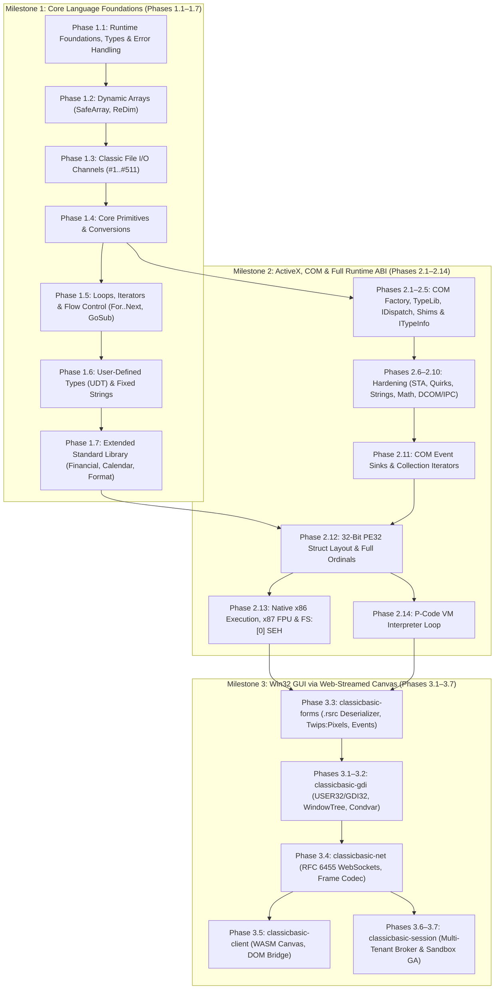

# ClassicBasic — Project Roadmap & Runtime Versioning

This document outlines the architectural milestones, tactical execution phases, versioning forecast, and completeness metrics for **ClassicBasic** (`msvbvm60` runtime and `vb6-run` loader).

---

## 1. Executive Summary & Runtime Versioning Policy

ClassicBasic adheres to Semantic Versioning (SemVer) with pre-release tags during active development. Every iteration and phase bumps the runtime version, reflecting newly implemented ABI exports, compiler helpers, or runtime subsystems.

### Current Version Status
- **Current Runtime Version**: `v0.2.11-alpha`
- **Active Milestone**: Milestone 1 — Core Language Foundations (`Phase 1.6` Done) / Milestone 2 — ActiveX, COM & Full ABI (`Phase 2.9` Done)
- **Active Phase**: Phase 1.6 (`v0.1.5`) & Phase 2.9 (`v0.2.9`) Done $\to$ Next: Phase 1.7 (`v0.1.6`) / Phase 2.10 (`v0.2.10`)
- **Regression Test Suite**: [`tests/v0_1_5_udt_fixed_strings.rs`](tests/v0_1_5_udt_fixed_strings.rs) & [`tests/v0_2_9_complex_math.rs`](tests/v0_2_9_complex_math.rs)
- **Verified Fixture**: `App21-udt-fixed-strings-native.exe` & `App21-udt-fixed-strings-pcode.exe`

### Overall Project Progress & Velocity Forecast
- **Overall Completion**: **~62%** (Real binary-level ABI compatibility: **~31.3%**)
- **Milestone 1 (Core Language Foundations)**: **~86%** (Phases 1.1–1.6: 100% Done; Phase 1.7: Planned)
- **Milestone 2 (ActiveX, COM & 100% ABI)**: **~50%** (Phases 2.1–2.9: 100% Done; Phases 2.10–2.14: Planned)
- **Milestone 3 (Win32 GUI via WebAssembly Canvas)**: **30%** (Header parsing, window tree, WebSocket mode; Phases 3.1–3.7: Planned)
- **Velocity**: Development averages **1 to 2 phases per sprint**.
- **Projected Completion Timeline**:
  - **Milestone 1 & 2 Full ABI Completion (v0.7.0)**: **Q1 2027** (Full 32-bit execution, P-Code interpreter, and all 635 exports).
  - **Milestone 3 / Release Candidate (v1.0.0)**: **Q2 2027** (Interactive Web-Streamed GUI canvas engine).

---

## 2. Roadmap Phases & Versioning Forecast

| Milestone | Phase | Version Forecast | Status | Deliverables & Scope | Regression Suite | Verified Fixtures |
| :--- | :--- | :---: | :---: | :--- | :--- | :--- |
| **Milestone 1** | **Core Language Foundations** | `v0.1.0` $\to$ `v0.1.6` | **In Progress (~86%)** | Console, CLI, memory primitives, BSTR/Variant, arrays, file channels, loops, UDTs, full `rtc*`/`__vba*` core | `v0_1_0_*` – `v0_1_6_*` | `App01`–`App10`, `App20`, `App21` |
| | ↳ *Phase 1.1: Runtime Foundations & CLI* | `v0.1.0` | **Done** | PE32 loader, `.reloc`, IAT resolver, Win32 console/file shims (`CreateFileA`, `WriteFile`), BSTR, Variant math, `On Error`, `ErrObject` | [`v0_1_0_*`](tests/) *(8 suites)* | `App01`–`App07` |
| | ↳ *Phase 1.2: Dynamic Arrays* | `v0.1.1` | **Done** | `SafeArray`, `ReDim`, `ReDim Preserve`, `LBound`, `UBound`, `Erase`, `Split`, `Join`, `Filter`, `Array()`, `Byte()` coercions | [`v0_1_1_dynamic_arrays.rs`](tests/v0_1_1_dynamic_arrays.rs) | `App08-arrays` |
| | ↳ *Phase 1.3: Classic File I/O* | `v0.1.2` | **Done** | Channel table (`#1..#511`), `FreeFile`, `Open`, `Close`, `Reset`, `Print #`, `Write #`, `Line Input #`, `Input #`, `Put #`, `Get #`, `Seek`, `LOF`, `EOF`, `Dir$` | [`v0_1_2_classic_fileio.rs`](tests/v0_1_2_classic_fileio.rs) | `App09-classic-fileio` |
| | ↳ *Phase 1.4: Core Primitives & Conversions* | `v0.1.3` | **Done** | `TypeName`, `IIf`, `Choose`, `Command$`, `Format$`, `Val`, `Str$`, `Round`, `Sqr`, `Abs`, `Sgn`, `Int`, `Fix`, conversions (`CLng`, `CDbl`, `CBool`, `CCur`, `CInt`, `CSng`) | [`v0_1_3_core_primitives.rs`](tests/v0_1_3_core_primitives.rs) | `App10-core-primitives` |
| | ↳ *Phase 1.5: Loops, Iterators & Flow Control* | `v0.1.4` | **Done** | Typed & `Variant`/`Currency` `For..Next` loop state helpers (`__vbaVarForInit`, `__vbaVarForNext`, `__vbaCyForInit`, `__vbaCyForNext`, `__vbaI2/I4/R4/R8ForNextCheck`), `For Each` array/variant iterators (`__vbaForEachAry`, `__vbaForEachVar`, `__vbaNextEach*`, `__vbaExitEach*`), `GoSub..Return` & `On..GoTo` (`__vbaGosub`, `__vbaGosubReturn`, `__vbaGosubFree`, `__vbaOnGoCheck`) | [`v0_1_4_loops_iterators.rs`](tests/v0_1_4_loops_iterators.rs) | `App20-loops-iterators` |
| | ↳ *Phase 1.6: User-Defined Types (UDT) & Fixed Strings* | `v0.1.5` | **Done** | `Type..End Type` UDT record copy, assignment, destruction & ANSI/Unicode marshaling (`CopyRecord`, `__vbaRecAssign`, `__vbaRecDestruct`, `__vbaRecDestructAnsi`, `__vbaRecAnsiToUni`, `__vbaRecUniToAnsi`, `__vbaAryRecCopy`, `__vbaAryRecMove`, `__vbaUdtVar`, `__vbaCVarAryUdt`, `__vbaUI1I2`), fixed-length strings `String * N` (`__vbaFixstrConstruct`, `__vbaStrFixstr`, `__vbaLsetFixstr*`, `__vbaRsetFixstr*`, `__vbaGetFxStr3/4`, `__vbaPutFxStr3/4`, `__vbaGetOwner3/4`, `__vbaPutOwner3/4`) | [`v0_1_5_udt_fixed_strings.rs`](tests/v0_1_5_udt_fixed_strings.rs) | `App21-udt-fixed-strings` |
| | ↳ *Phase 1.7: Extended Standard Library (`rtc*`)* | `v0.1.6` | **Planned** *(Next)* | Remaining ~95 `rtc*` exports: financial suite (`rtcPMT`, `rtcPPMT`, `rtcIPMT`, `rtcPV`, `rtcFV`, `rtcNPer`, `rtcRate`, `rtcIRR`, `rtcMIRR`, `rtcNPV`, `rtcSLN`, `rtcSYD`, `rtcDDB`), calendar math (`rtcDateAdd`, `rtcDateDiff`, `rtcDatePart`, `rtcPackDate`, `rtcPackTime`, `rtcWeekdayName`, `rtcMonthName`), locale formatters (`rtcFormatNumber`, `rtcFormatCurrency`, `rtcFormatPercent`, `rtcFormatDateTime`, `rtcSwitch`, `rtcPartition`), and registry settings (`rtcGetSetting`, `rtcSaveSetting`, `rtcDeleteSetting`, `rtcGetAllSettings`) | `v0_1_6_extended_rtc.rs` | Extended RTC Library Suite |
| **Milestone 2** | **ActiveX, COM & 100% Runtime ABI** | `v0.2.1` $\to$ `v0.5.0` | **In Progress (~50%)** | In-process COM, TypeLib parser, late binding, shims, hardening, 32-bit ABI, x86/P-Code VM | `v0_2_1_*` – `v0_5_0_*` | `App11`–`App19` |
| | ↳ *Phase 2.1: Discovery & Factory* | `v0.2.1` | **Done** | Virtual `registry.json`, `DllGetClassObject`, `IClassFactory`, `rtcCreateObject2`, error 429, `__vbaObjIs`, `__vbaObjSetAddref` | [`v0_2_1_com_instantiation.rs`](tests/v0_2_1_com_instantiation.rs) | `App11-com-factory` |
| | ↳ *Phase 2.2: Introspection & TypeLib* | `v0.2.2` | **Done** | MSFT `.tlb` binary reader (`MSFT\x02\x00\x01\x00`), `DispidCache`, `__vbaNew`, `__vbaCastObj`, `IDictionary` dual vtable | [`v0_2_2_typelib_parser.rs`](tests/v0_2_2_typelib_parser.rs) | `App12-typelib-introspection` |
| | ↳ *Phase 2.3: Late-Binding Dispatch* | `v0.2.3` | **Done** | `IDispatch` (`GetIDsOfNames`, `Invoke`), `__vbaLateIdCall*`, `__vbaLateMemCall*`, `__vbaVarLateMem*`, `DISPPARAMS` | [`v0_2_3_dispatch_engine.rs`](tests/v0_2_3_dispatch_engine.rs) | `App13-late-binding-dispatch` |
| | ↳ *Phase 2.4: ActiveX Shims* | `v0.2.4` | **Done** | `Scripting.FileSystemObject` & `TextStream`, `WScript.Shell`, `WScript.Network`, `ADODB.Recordset`, `rtcGetObject` | [`v0_2_4_activex_shims.rs`](tests/v0_2_4_activex_shims.rs) | `App14-activex-shims` |
| | ↳ *Phase 2.5: Self-Describing ITypeInfo* | `v0.2.5` | **Done** | Built-in `ITypeInfo` vtable on native shims, dynamic `rtcCallByName` (715), COM `TypeName` reflection | [`v0_2_5_consolidation_typeinfo.rs`](tests/v0_2_5_consolidation_typeinfo.rs) | `App15-activex-consolidation` |
| | ↳ *Phase 2.6: Threading & STA Concurrency* | `v0.2.6` | **Done** | Per-thread TLS `ErrObject` isolation, STA cross-thread rejection (`RPC_E_WRONG_THREAD`), atomic `AddRef`/`Release`, `Eb*` contexts | [`v0_2_6_threading_apartments.rs`](tests/v0_2_6_threading_apartments.rs) | `App16-threading-sta-concurrency` |
| | ↳ *Phase 2.7: Esoteric Quirks & Zombie Objects* | `v0.2.7` | **Done** | Zombie object lockout (`E_UNEXPECTED`), SafeArray lock violations (Error 10), ByRef aliasing, deep ByRef variant deref, SEH unwinding | [`v0_2_7_esoteric_zombie_aliasing.rs`](tests/v0_2_7_esoteric_zombie_aliasing.rs) | `App17-esoteric-quirks` |
| | ↳ *Phase 2.8: Complex Strings & Codepages* | `v0.2.8` | **Done** | BSTR embedded nulls (`\0`), bidirectional `StrConv` (Unicode/ANSI Windows-1252 & casing), `Like` pattern matching (`__vbaStrLike`), `vbNullString` zero pointer | [`v0_2_8_complex_strings.rs`](tests/v0_2_8_complex_strings.rs) | `App18-complex-strings` |
| | ↳ *Phase 2.9: Complex Math, Rounding & FDIV* | `v0.2.9` | **Done** *(Current)* | Exact Banker's Rounding (round-to-even), Pentium FDIV workarounds (`_adj_fdiv*`), 128-bit Currency math, `_CI*` transcendental functions, 96-bit Variant Decimal arithmetic | [`v0_2_9_complex_math.rs`](tests/v0_2_9_complex_math.rs) | `App19-math-rounding` |
| | ↳ *Phase 2.10: DCOM, IPC & Running Object Table* | `v0.2.10` | **Planned** *(Next)* | Running Object Table (`IRunningObjectTable`), out-of-process ActiveX EXE (`LocalServer32`) IPC proxy, connection points | `v0_2_10_dcom_ipc.rs` | `App22-dcom-ipc` |
| | ↳ *Phase 2.11: COM Event Sinks & Collection Iterators* | `v0.2.11` | **Planned** | `__vbaRaiseEvent`, `EVENT_SINK_QueryInterface/AddRef/Release/Invoke`, `For Each` COM collection iterators (`__vbaForEachCollObj`, `__vbaForEachCollVar`, `IEnumVARIANT`), named-arg late binding (`__vbaLateIdNamedCall*`, `__vbaLateMemNamedCall*`) | `v0_2_11_event_sinks_collections.rs` | Event Sinks & Collections Suite |
| | ↳ *Phase 2.12: 32-Bit ABI & Full Ordinal Wiring* | `v0.3.0` | **Planned** | 32-bit struct alignment (`SafeArray` / `Variant` / vtables), `__stdcall` stack cleanup (`ret N`) in stubs, 100% ordinal-to-symbol wiring (635 exports) | `v0_3_0_abi32_ordinals.rs` | Full Ordinal & ABI Suite |
| | ↳ *Phase 2.13: Native x86 Execution, x87 FPU & SEH* | `v0.4.0` | **Planned** | 32-bit x86 direct instruction execution, hardware x87 `st(0)` FPU intrinsics, `__vbaChkstk`, Win32 TEB `FS:[0]` SEH exception unwinding | `v0_4_0_native_x86_fpu_seh.rs` | x86 Native Runner Suite |
| | ↳ *Phase 2.14: P-Code VM Interpreter* | `v0.5.0` | **Planned** | Full `ProcCallEngine` & `MethCallEngine` bytecode interpreter loop over `RTMI` metadata, 1,100+ opcodes (`0x00..0xFA` + `Lead0`..`Lead4` extended tables) | `v0_5_0_pcode_vm.rs` | P-Code VM Suite |
| **Milestone 3** | **Win32 GUI (Web-Streamed Canvas)** | `v0.75.0` $\to$ `v1.0.0` | **In Progress (~30%)** | Clean-room USER32/GDI32, Twips-to-Pixels, WebSockets, WASM Canvas client | `v0_75_0_*` – `v1_0_0_*` | GUI Suites |
| | ↳ *Phase 3.1: Virtual Windowing & Condvar Loop* | `v0.75.0` | **Planned** | `VirtualWindowTree`, `VirtualDC`, `VirtualMessageQueue` (`Condvar`), `GetMessageA`, `PeekMessageA`, `RegisterClassA`, `CreateWindowExA` | `v0_75_0_virtual_windowing.rs` | Virtual Windowing Suite |
| | ↳ *Phase 3.2: GDI Drawing Surface & Font Metrics* | `v0.80.0` | **Planned** | 32-bit BGRA surface, geometry (`Rectangle`, `Ellipse`, `LineTo`), 96 DPI font metrics (`GetTextExtentPoint32A`), `TextOutA` interception | `v0_80_0_gdi_surface.rs` | GDI Surface Suite |
| | ↳ *Phase 3.3: Form Deserializer & Event Sinks* | `v0.85.0` | **Planned** | PE32 `.rsrc` `ThunderRT6FormDC` parser, Twips-to-Pixels ($15:1$), control instantiation, `WM_LBUTTONUP` $\to$ `ObjectTable` callback dispatch | `v0_85_0_form_deserializer.rs` | Form Deserializer Suite |
| | ↳ *Phase 3.4: Atomic Wire Protocol & WebSockets* | `v0.90.0` | **Planned** | Hand-rolled RFC 6455 WebSocket engine, atomic `0x02 FRAME_BITMAP_RECT`, `0x07 FRAME_TEXT`, client JSON event decoder | `v0_90_0_websocket_protocol.rs` | WebSocket Protocol Suite |
| | ↳ *Phase 3.5: WASM Canvas Client Engine* | `v0.95.0` | **Planned** | `wasm32-unknown-unknown` renderer, minimal JS runtime ($<200$ lines), Canvas 2D `putImageData` & `fillText`, DOM event pipeline | `v0_95_0_wasm_client.rs` | WASM Client Suite |
| | ↳ *Phase 3.6: Multi-Tenant Session Broker* | `v0.98.0` | **Planned** | `classicbasic-session` orchestrator, dynamic container provisioning, internal TCP WebSocket reverse proxy, session isolation | `v0_98_0_session_broker.rs` | Multi-Tenant Broker Suite |
| | ↳ *Phase 3.7: Sandboxed System Providers & GA* | `v1.0.0` | **Planned** | Unified `SandboxProvider` trait (`--registry=local` / `--registry=remote`), v1.0.0 production general availability | `v1_0_0_sandbox_ga.rs` | Enterprise E2E GA Suite |

---

## 3. Subsystem Completeness & ABI Compatibility Matrix

This matrix provides a detailed breakdown of implementation fidelity across the runtime's architectural subsystems:

| Subsystem | Completed Functions / Items | Total Scope | Status | Key Implemented Capabilities | Remaining Gaps for 100% Fidelity |
| :--- | :---: | :---: | :---: | :--- | :--- |
| **Export Symbol Wiring (`resolver.rs`)** | **199 wired** | **635 ordinals** | **31.3%** | 199 ordinals dynamically mapped to native implementations; remaining 436 export ordinals stubbed. | Wire remaining 436 ordinals to native/emulated implementations across Phases 1.7 & 2.10–2.14. |
| **Export Definition Table (`msvbvm60.def`)** | **635 exports** | **635 ordinals** | **100%** | All 635 ordinals (100–2010) cataloged in DEF file and resolvable by loader. | None (DEF file is complete). |
| **Memory Primitives (`src/mem.rs`)** | **22 functions** | **22 functions** | **100%** | `VarPtr`, `GetMem1..8`, `PutMem1..8`, `GetMemStr`, `PutMemStr`, `GetMemVar`, `PutMemVar`, `GetMemObj`, `PutMemObj`, `SetMemVar`, `SetMemObj`, `GetMemNewObj`, `PutMemNewObj`, `SetMemNewObj`, `GetMemEvent`, `PutMemEvent`, `SetMemEvent`. | None (primitives fully operational). |
| **Core Automation Types (`src/types/`)** | **4 types** | **4 types** | **95%** | BSTR (length prefix, UTF-16, in-place `Mid$`, `SysAllocStringByteLen`), Variant (tagged union, arithmetic coercion, ByRef chaining, deep `to_byval`, `VT_DECIMAL` 96-bit exact integer arithmetic, `VT_RECORD` UDT), SafeArray (multi-dimensional, `c_locks`, dynamic bounds, UDT element support), Currency (64-bit fixed point, 128-bit intermediate math & Banker's Rounding). | 32-bit pointer alignment on 64-bit host (`u32` vs `usize` — Phase 2.12). |
| **Error Handling (`src/err.rs`)** | **8 functions** | **8 functions** | **95%** | `__vbaOnError` (modes -1, 0, >0), `__vbaResume`, `__vbaExitProc`, thread-local SEH frame stack, re-entrant error unwinding (`unwind_to_handler`), `ErrObject` dual-interface COM vtable (`Number`, `Description`, `Source`, `Raise`, `Clear`, `LastDllError`). | Win32 hardware exception trap translation (`FS:[0]` — Phase 2.13). |
| **COM, ActiveX & TypeLib (`com`, `typelib`, `activex`)** | **~35 functions** | **~50 functions** | **70%** | `registry.json`, `DllGetClassObject`, `IClassFactory`, `ITypeLib`/`ITypeInfo` parser (MSFT TypeLib format), `IDictionary` dual vtable, `IDispatch` late binding, `FSO`, `WScript.Shell`, `WScript.Network`, `ADODB.Recordset`, `CallByName`, `Zombie_*` lifecycle. | `__vbaRaiseEvent`, `EVENT_SINK_*`, `IConnectionPointContainer` (Phase 2.11), out-of-process IPC (`LocalServer32` — Phase 2.10). |
| **Compiler Helpers (`src/vba/mod.rs`)** | **~160 functions** | **~280 functions** | **57.1%** | String copy/cat/move, UDT record copy/assign/destruct (`CopyRecord`, `__vbaRecAssign`, `__vbaRecDestruct*`), fixed-string helpers (`__vbaFixstrConstruct`, `__vbaStrFixstr`, `__vbaLsetFixstr*`, `__vbaRsetFixstr*`, `__vbaGetFxStr*`, `__vbaPutFxStr*`), Variant math, Banker's rounding, Currency 128-bit math, `For..Next` typed checkers, array iteration, `GoSub`, computed jump check, `__vbaRedim`, `__vbaRedimPreserve`, `__vbaErase`, `__vbaLate*`, `__vbaObj*`, `Like` matchers. | Remaining ~120 helpers: COM collection `For Each` & event sinks (Phase 2.11). |
| **Standard Library (`src/rtc/mod.rs`)** | **~95 functions** | **~190 functions** | **50.0%** | Transcendental math (`rtcSin`, `rtcCos`, `rtcTan`, `rtcAtn`, `rtcExp`, `rtcLog`, `rtcSqr`), Banker's rounding (`rtcRound`), Decimal conversion (`rtDecFromVar`), string utilities (`Left$`, `Right$`, `Mid$`, `Trim$`, `UCase$`, `LCase$`, `Replace`, `InStrRev`, `String$`, `StrConv`), conversions (`CBool`, `CInt`, `CLng`, `CDbl`, `CCur`), inspection (`TypeName`, `IsNumeric`, `IsEmpty`, `IsNull`), file channels (`Open`, `Print #`, `Get #`, `Put #`), system (`Environ$`, `CurDir$`, `Date$`, `Time$`, `Timer`). | Remaining ~95 functions: financial suite (`PMT`, `NPV`, `IRR`), calendar math (`DateAdd`, `DateDiff`), formatting (`FormatNumber`, `FormatDateTime`), registry settings (`GetSetting`, `SaveSetting`) (Phase 1.7). |
| **Native x86 Execution Engine** | **Loader + Virtual FPU** | **Full CPU Emulation** | **20%** | PE32 section mapping, IAT patching, base relocations, `VB5!` header detection, Virtual x87 FPU circular 8-register stack, C0..C3 condition codes, Pentium FDIV bug workarounds (`_adj_fdiv*`), CRT math intrinsics (`_CI*`). | Direct x86 instruction execution on `x86_64`, Win32 TEB `FS:[0]` SEH exception unwinding (Phase 2.13). |
| **P-Code VM Interpreter** | **Header Parsing** | **1,100+ opcodes** | **5%** | Header recognition, `ProcCallEngine` / `MethCallEngine` entry-point hooking, P-Code binary execution in test suites. | Full instruction fetch-decode-execute loop across standard and extended opcode tables (`Lead0`–`Lead4` — Phase 2.14). |
| **Win32 GUI Subsystem** | **Architecture & Window Tree** | **Interactive Web Canvas** | **30%** | Mode flag `--gui-web`, Form/control metadata parsing, headless message loop skeleton. | `.rsrc` visual template deserializer, GDI canvas bridge, WebSocket streaming server (Phases 3.1–3.7). |

---

## 4. Component Dependency Graph

---

## 5. Milestone 3 Architecture & Detailed Design Specification

> [!NOTE]
> For the complete technical blueprint, see **[`docs/architecture/win32-gui-gdi.md`](docs/architecture/win32-gui-gdi.md)**.

### Architectural Directives & Critical Rules

1. **Text Rendering Pipeline (Server-Client Split)**:
   - Server-side GDI engine (`classicbasic-gdi`) **never** rasterizes glyphs into the BGRA framebuffer.
   - Server maintains DC text state (`SetTextColor`, `SetBkColor`, `SetBkMode`, current font metadata) and intercepts `TextOutA`/`TextOutW`/`ExtTextOutA` to emit structured binary `0x07 FRAME_TEXT` commands.
   - Computes layout boundaries using an embedded, static 96 DPI font metric lookup table (MS Sans Serif / Tahoma canonical widths) via `GetTextExtentPoint32A`.
   - Client WebAssembly engine consumes `FRAME_TEXT` and paints directly to HTML5 Canvas via `ctx.fillText()` / `ctx.strokeText()`.
2. **Coordinate Normalization (Twips to Pixels)**:
   - All internal VB6 form definitions (`.rsrc`, `ThunderRT6FormDC`) store dimensions in Twips ($1 \text{ pixel} = 15 \text{ Twips}$ at 96 DPI).
   - Conversion equation: $\text{pixels} = \lfloor \text{twips} / 15 \rfloor, \quad \text{twips} = \text{pixels} \times 15$.
   - Coordinates exposed via Win32 APIs (`GetClientRect`, `GetWindowRect`) are normalized physical virtual pixels.
3. **Atomic Frame Protocol (Tearing Elimination)**:
   - Dirty regions and pixel payloads are merged into an atomic `0x02 FRAME_BITMAP_RECT` frame, removing multi-packet tearing and synchronization artifacts.
4. **Non-Blocking Message Loop & Condvar Synchronization**:
   - `VirtualMessageQueue` in `classicbasic-gdi` uses a thread-safe MPSC queue backed by `std::sync::Condvar`.
   - `GetMessageA` blocks the UI execution thread on the condition variable until network input frames (`mouse`, `key`, `resize`) arrive via `classicbasic-net`, eliminating CPU spin-locking.
   - `PeekMessageA` inspects the queue non-blockingly.
5. **Control Event Sink & Callback Dispatch**:
   - `classicbasic-forms` parses `VBHeader -> ObjectTable -> ControlTable` to bind control event offsets (e.g. `_Click`, `_Change`).
   - When a `VirtualWindow` receives `WM_LBUTTONUP`, its window procedure invokes the compiled event handler in `.text` via `ThunRTMain` dispatch helpers.

### Subsystem Decomposition

| Crate / Component | Kind | Role |
| :--- | :--- | :--- |
| `classicbasic-runtime` (`msvbvm60`) | cdylib + rlib | VB6 VM ABI, BSTR/VARIANT/SAFEARRAY, `rtc*`, `__vba*`, COM, Registry, PE loader. |
| `classicbasic-gdi` | rlib | Clean-room USER32 + GDI32: Window tree, DCs, pens/brushes, font metrics, atomic dirty blits. |
| `classicbasic-forms` | rlib | `.rsrc` deserializer (`ThunderRT6FormDC`), Twips-to-Pixels converter, COM control event wiring. |
| `classicbasic-net` | rlib | RFC 6455 WebSocket server, HTTP handshake, session frame codec, static WASM asset server. |
| `classicbasic-gui` | bin | Entrypoint for `vb6-run --gui-web`. Merges runtime + gdi + forms + net into one runner. |
| `classicbasic-session` | bin | Multi-tenant broker: container provisioning, reverse-proxy, sandbox volume orchestration. |
| `classicbasic-client` | wasm32-unknown-unknown | Canvas renderer, WebSocket client, DOM event bridge. Compiled to static `.wasm`. |

### Wire Protocol Frame Definitions

Binary frames adhere to `type: u8 | len: u32 (LE) | payload`:

| Opcode | Identifier | Layout / Payload | Description |
| :---: | :--- | :--- | :--- |
| `0x02` | `FRAME_BITMAP_RECT` | `x:u16, y:u16, w:u16, h:u16, raw_bytes:[u8]` | Atomic dirty rectangle bitmap in BGRA. |
| `0x03` | `FRAME_FORM` | Serialized JSON-like metadata of virtual controls. | Structural hierarchy for hit-testing & a11y. |
| `0x04` | `FRAME_DIALOG` | `style:u32, title_len:u16, title:str, msg:str` | Trigger client-rendered native modal dialog. |
| `0x05` | `FRAME_CURSOR` | `cursor_id:u16` | Pointer style updates (arrow, hourglass, caret). |
| `0x06` | `FRAME_CLIPBOARD` | `text_len:u32, text:str` | Bidirectional clipboard synchronization. |
| `0x07` | `FRAME_TEXT` | `x:u16, y:u16, fg:u32, bg:u32, font_id:u8, text:str` | Delegated text rendering command for client Canvas. |

---

## 6. Milestone Versioning Calculation (Roadmap to 1.0.0)

Version progression strictly models subsystem maturity toward the `1.0.0` production milestone:

$$\begin{aligned} \text{Total Progress} &= (\text{M1 Weight} \times 0.86) + (\text{M2 Weight} \times 0.50) + (\text{M3 Weight} \times 0.30) \\ &= (0.45 \times 0.86) + (0.35 \times 0.50) + (0.20 \times 0.30) \\ &= 0.3870 + 0.1750 + 0.0600 = 0.6220 \implies \mathbf{\sim 62\%} \text{ Overall} \end{aligned}$$

| Milestone | Scope / Deliverable | Weight | Status | Version Range |
| :--- | :--- | :---: | :---: | :---: |
| **Milestone 1** | Core Language Foundations (Phases 1.1–1.7: PE32, Arrays, File I/O, Primitives, Loops, UDTs, Extended RTC) | 45% | **~86% Complete** (Phases 1.1–1.6 Done) | `v0.1.0` $\to$ `v0.1.6` |
| **Milestone 2** | ActiveX, COM & 100% Runtime ABI (Phases 2.1–2.14: Registry, TypeLib, IDispatch, Shims, Hardening, 32-Bit ABI, x86/P-Code VM) | 35% | **~50% Complete** (Phases 2.1–2.9 Done) | `v0.2.1` $\to$ `v0.5.0` |
| **Milestone 3** | Win32 GUI via Web-Streamed Canvas (Phases 3.1–3.7: Virtual Windowing, GDI, Form Deserializer, WebSockets, WASM, Broker) | 20% | **~30% Complete** | `v0.70.0` $\to$ `v1.0.0` |

---

## 7. Tactical Execution Strategy

### Sprint Cadence & Governance
1. **Container-First**: Every iteration must compile cleanly with `podman build -t classicbasic:latest .` and pass all retroactive regression binaries (`tests/retroactive_binaries.rs`).
2. **Clean-Room Enforcement**: Zero proprietary Microsoft or Wine code; all behavior is inferred from public MSDN behavioral specifications and fixture execution traces.
3. **No New Dependencies**: Maintain a minimal, zero-bloat footprint with hand-rolled parsers and zero external dependencies in `Cargo.toml`.
4. **Retroactive Guarantee**: Every new phase adds tests for both compiled Native Code and P-Code PE32 binaries to ensure no regressions across previously completed milestones.
