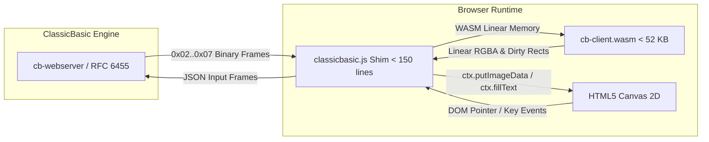

# `cb-client`: WebAssembly HTML5 Canvas 2D Client & JS Bridge

`cb-client` is a zero-dependency, clean-room WebAssembly (`wasm32-unknown-unknown`) client library and minimal JavaScript bridge that renders remote Win32 desktop and form surfaces onto HTML5 Canvas 2D contexts, while capturing browser DOM pointer, keyboard, and resize events to serialize into ClassicBasic JSON input frames.

---

## Architecture & Capabilities

### 1. Binary Wire Protocol Decoder (`decoder.rs`)
Directly decodes the binary wire frames streamed from `cb-webserver`:
* **`0x02 FRAME_BITMAP_RECT`**: Dirty rectangular pixel updates with 32-bit BGRA data.
* **`0x03 FRAME_FORM`**: Window geometry, styles, caption, and child controls snapshot.
* **`0x04 FRAME_DIALOG`**: Modal MsgBox / InputBox requests with buttons and prompts.
* **`0x05 FRAME_CURSOR`**: Cursor shape IDs and coordinates.
* **`0x06 FRAME_CLIPBOARD`**: Clipboard synchronization payloads.
* **`0x07 FRAME_TEXT`**: Delegated vector text operations.

### 2. High-Performance Pixel Blitter & Linear Surface (`surface.rs`)
* Converts Win32 GDI 32-bit BGRA (`0x02 FRAME_BITMAP_RECT`) scanlines to standard linear RGBA memory in-place ($R=BGRA[2], G=BGRA[1], B=BGRA[0], A=BGRA[3]$).
* Clips arbitrary bounding rectangles against surface boundaries.
* Accumulates dirty rectangular damage unions across multiple blits for atomic Canvas 2D updates via `ctx.putImageData`.

### 3. Delegated Vector Text Queue (`text.rs`)
* Formats Win32 `COLORREF` values (`0x00BBGGRR`) into standard CSS colors (`rgb(r, g, b)`).
* Normalizes font heights into CSS font strings (e.g. `14px sans-serif`).
* Buffers commands in a FIFO queue for batch flushing by the JavaScript shim.

### 4. DOM Input Event Encoder (`input.rs`)
Encodes client interactions into JSON frames matching `cb-webserver::input::parse_client_input`:
* Pointer events: `mouse.move`, `mouse.down`, `mouse.up`.
* Keyboard events: `key.down`, `key.up`, `char`.
* Window geometry: `resize`.
* Dialog responses: `dialog.result`.

### 5. Zero-Dependency WebAssembly C ABI (`ffi.rs`)
Exposes bare C ABI exports callable directly via `WebAssembly.Instance.exports` without requiring `wasm-bindgen` or `web-sys`:
* `cb_client_create(width, height)`: Creates a client session.
* `cb_client_destroy(client)`: Releases client memory.
* `cb_client_alloc(size)` / `cb_client_free(ptr, size)`: Manages linear memory transfer buffers.
* `cb_client_process_message(client, data_ptr, data_len)`: Decodes and applies binary frames.
* `cb_client_framebuffer_ptr(client)` / `cb_client_framebuffer_len(client)`: Direct pointer to RGBA memory.
* `cb_client_dirty_rect(client, out_rect)`: Consumes dirty rectangle coordinates.
* `cb_client_text_command_count(client)` / `cb_client_drain_text_json(client, buf, max)`: Batched text drawing.
* `cb_client_encode_mouse`, `cb_client_encode_key`, `cb_client_encode_resize`: Host-side event serialization.

### 6. Minimal JavaScript Shim (`assets.rs`)
* Vanilla JavaScript bridge class `ClassicBasicClient` under 150 lines.
* Binds WebSocket binary streams directly to the WebAssembly memory instance.
* Attaches pointer capture, keyboard hooks, and resize observers.
* Total compiled release WASM binary size: **52 KB** (well within the $< 100\text{ KB}$ roadmap requirement).

---

## Test Suites (`crates/cb-client/tests/`)

1. **`decoder_tests.rs`**: Full coverage of all frame opcodes (`0x02`..`0x07`), truncated payload error detection, and string handling.
2. **`surface_blitter_tests.rs`**: BGRA -> RGBA channel conversion precision, boundary clipping, dirty rectangle union, clear, and resize behavior.
3. **`text_pipeline_tests.rs`**: CSS color formatting from `COLORREF`, font height metrics, and FIFO queue lifecycle.
4. **`input_encoder_tests.rs`**: Round-trip integration tests between `InputEncoder` output and `cb-webserver::input::parse_client_input`.
5. **`wasm_ffi_tests.rs`**: End-to-end testing of raw memory allocation, pointer dereferencing, dirty rect retrieval, and text JSON draining.
