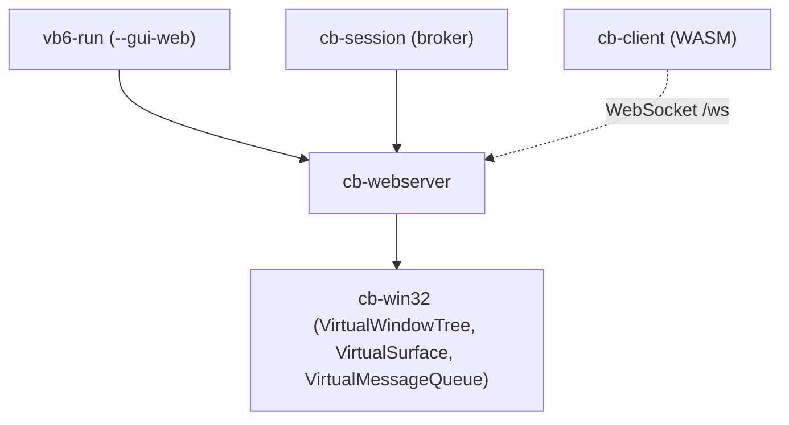

# cb-webserver

Clean-room **HTTP/1.1 + RFC 6455 WebSocket server** and **atomic GUI wire protocol codec** for ClassicBasic.

`cb-webserver` is the network edge of the Web-Streamed GUI (Milestone 3, **Phase 3.6 / `v0.3.6`**). It streams the virtual Win32 desktop held by `cb-win32` (windows, GDI surfaces, forms, cursor, clipboard, text runs) to a browser, and turns browser input back into `Win32Msg` entries on the `VirtualMessageQueue`.

> **Status:** crate scaffolded in Phase 3.6 source preparation. The implementation and test suite land once the `App40-gui-websocket-stream` binaries are available.

---

## 1. Design Constraints

| Constraint | Rule |
|---|---|
| Dependencies | **Zero external crates.** Only `std` + `cb-win32`. SHA-1, Base64, HTTP parsing, WebSocket framing and JSON input parsing are hand-rolled. |
| Clean room | Behavior derived only from public specs: RFC 6455, RFC 7230, FIPS 180-4, RFC 4648, Win32 message semantics. |
| No mocks | Tests drive real `TcpListener`/`TcpStream` loopback sockets and the real `cb-win32` window tree / message queue. |
| Tests in-domain | Every test lives in `crates/cb-webserver/tests/`. |
| Endianness | All multi-byte wire integers are **little-endian**, except RFC 6455 extended payload lengths (network order, per spec). |

---

## 2. Position in the Workspace



---

## 3. Module Layout

| Module | Responsibility |
|---|---|
| `sha1` | FIPS 180-4 SHA-1 (used for `Sec-WebSocket-Accept`). |
| `base64` | RFC 4648 standard alphabet encoder/decoder with padding. |
| `http` | HTTP/1.1 request-line + header parser, `GET` static asset routing, `Upgrade: websocket` validation, `101 Switching Protocols` response. |
| `frame` | RFC 6455 frame codec: FIN/RSV/opcode, 7/16/64-bit payload lengths, mandatory client masking (unmask on read, reject unmasked), continuation/fragmentation, `ping`→`pong`, `close` handshake with status code. |
| `wire` | Atomic binary display frames `0x02`..`0x07` (Section 5). |
| `input` | Minimal JSON object parser for input frames (Section 6) producing `Win32Msg`. |
| `server` | `TcpListener` accept loop, one session per connection, outbound frame queue, `Condvar` wake-up of the VB6 message pump. |

---

## 4. Handshake

```
Sec-WebSocket-Accept = Base64( SHA1( Sec-WebSocket-Key + "258EAFA5-E914-47DA-95CA-C5AB0DC85B11" ) )
```

Reference vector (RFC 6455 §1.3): key `dGhlIHNhbXBsZSBub25jZQ==` → accept `s3pPLMBiTxaQ9kYGzzhZRbK+xOo=`.

Requests missing `Upgrade: websocket`, `Connection: Upgrade`, `Sec-WebSocket-Version: 13` or a 16-byte Base64 key are answered with `400 Bad Request`.

---

## 5. Server → Client Display Frames (WebSocket binary messages)

Every display frame is one WebSocket binary message: `opcode:u8` followed by the payload.

| Opcode | Name | Payload | Source surface |
|---|---|---|---|
| `0x02` | `FRAME_BITMAP_RECT` | `hwnd:u32, x:u16, y:u16, w:u16, h:u16, pixels: w*h*4 (BGRA)` | `VirtualSurface` dirty rects (`InvalidateRect`, GDI writes) |
| `0x03` | `FRAME_FORM` | `hwnd:u32, x:i16, y:i16, w:u16, h:u16, style:u32, caption: str16, n_controls:u16, controls[]` | `VirtualWindowTree` / `FormRuntime` |
| `0x04` | `FRAME_DIALOG` | `dialog_id:u32, kind:u8 (msgbox/inputbox), buttons:u32, title: str16, prompt: str16, default: str16` | `rtcMsgBox` / `rtcInputBox` |
| `0x05` | `FRAME_CURSOR` | `cursor_id:u16 (IDC_*), x:i16, y:i16` | `SetCursor`, `SetCursorPos` |
| `0x06` | `FRAME_CLIPBOARD` | `format:u16 (CF_TEXT), data: str32` | `Clipboard.SetText` |
| `0x07` | `FRAME_TEXT` | `hwnd:u32, x:i16, y:i16, color:u32, bk_mode:u8, font_height:i16, text: str16` | `TextOutA`, `DrawTextA` |

`str16` = `len:u16` + UTF-8 bytes; `str32` = `len:u32` + UTF-8 bytes.
`control` = `hwnd:u32, kind:u8, x:i16, y:i16, w:u16, h:u16, text: str16`.

---

## 6. Client → Server Input Frames (WebSocket text messages, JSON)

| `type` | Fields | Resulting message(s) |
|---|---|---|
| `mouse.move` | `hwnd, x, y, buttons` | `WM_MOUSEMOVE`, `wParam = MK_*`, `lParam = MAKELPARAM(x, y)` |
| `mouse.down` / `mouse.up` | `hwnd, x, y, button (0=L,1=M,2=R)` | `WM_LBUTTONDOWN/UP`, `WM_MBUTTONDOWN/UP`, `WM_RBUTTONDOWN/UP` |
| `key.down` / `key.up` | `hwnd, vk, repeat` | `WM_KEYDOWN` (`lParam = repeat`), `WM_KEYUP` (`lParam = 0xC0000001`) |
| `char` | `hwnd, code` | `WM_CHAR`, `wParam = code`, `lParam = 1` |
| `resize` | `hwnd, width, height` | `WM_SIZE`, `wParam = SIZE_RESTORED`, `lParam = MAKELPARAM(w, h)` |
| `dialog.result` | `dialog_id, result, text?` | Completes the pending modal `FRAME_DIALOG` and unblocks the VB6 thread |

Every injected message is pushed to the `VirtualMessageQueue` and the queue `Condvar` is notified, waking `GetMessageA` in the VB6 thread.

---

## 7. Test Suite (`crates/cb-webserver/tests/`)

| File | Coverage |
|---|---|
| `crypto_codecs.rs` | SHA-1 FIPS vectors, Base64 RFC 4648 vectors, handshake accept key. |
| `http_upgrade.rs` | Request parsing, header validation, `101` / `400` responses over loopback sockets. |
| `websocket_frames.rs` | Frame encode/decode, 7/16/64-bit lengths, masking, fragmentation, ping/pong, close codes. |
| `wire_protocol.rs` | `0x02`..`0x07` encoders driven by a real `cb-win32` window tree and surface. |
| `input_frames.rs` | JSON input parsing to `Win32Msg` and `Condvar` wake-up on the real message queue. |
| `server_e2e.rs` | Full loopback session: handshake, input injection, display frame streaming, close. |

Run:

```bash
cargo test -p cb-webserver
```

Retroactive binary validation: `App40-gui-websocket-stream` (native + p-code) in `crates/vb6-run/tests/retroactive_binaries.rs`.
