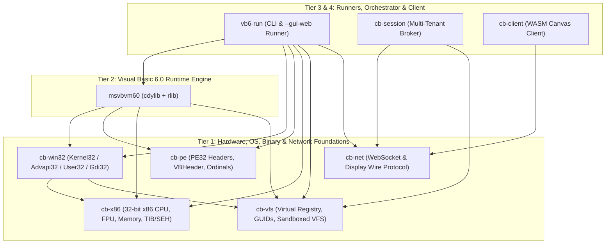

# ClassicBasic Cargo Workspace Architecture

## 1. Executive Summary

ClassicBasic is organized as a modular, peer-level **Cargo Workspace** (`crates/*`) with a strict **Directed Acyclic Graph (DAG)** of dependencies.

Previously, hardware emulation (`x86`), PE32 headers (`pe`), Win32 OS shims (`win32`), virtual registry/filesystem (`vfs`), and the standalone runner (`vb6-run`) lived inside the `msvbvm60` library tree. The workspace reorganization elevates every major subsystem to a first-class peer crate under `crates/`, ensuring:
1. **`msvbvm60` and `vb6-run` sit at peer structural levels**: `msvbvm60` is the Visual Basic 6.0 Runtime DLL & COM/VM foundation, while `vb6-run` is the standalone CLI and Web-Streamed GUI runner that consumes `msvbvm60`, `cb-pe`, `cb-win32`, `cb-x86`, `cb-vfs`, and `cb-net`.
2. **Hardware, OS, Binary, and Network Foundations are decoupled from VB6**: `cb-x86`, `cb-pe`, `cb-vfs`, `cb-win32`, and `cb-net` have zero dependency on `msvbvm60`.

---

## 2. Workspace Directory Layout

```text
classicbasic/
├── Cargo.toml                  # Virtual Workspace Manifest ([workspace] members = ["crates/*"])
├── crates/
│   ├── cb-x86/                 # [Tier 1: Hardware Foundation] 32-bit x86 CPU, EFLAGS, x87 FPU, Linear Memory, TIB/SEH
│   ├── cb-pe/                  # [Tier 1: Binary Foundation] PE32 headers, VB5! metadata headers, 635-ordinal table
│   ├── cb-vfs/                 # [Tier 1: Sandbox Foundation] Virtual Registry (registry.json), GUID/CLSID/IID, VFS paths
│   ├── cb-win32/               # [Tier 1: OS Foundation] Kernel32/Advapi32/User32/Gdi32 shims, Windowing & Surface32
│   ├── cb-net/                 # [Tier 1: Network Foundation] RFC 6455 WebSocket & Display Wire Protocol (0x02..0x07)
│   ├── msvbvm60/               # [Tier 2: VB6 Runtime Foundation] MSVBVM60.DLL (635 exports, BSTR/Variant/SafeArray, COM, P-Code, x86 IAT Bridge)
│   ├── vb6-run/                # [Tier 3: Execution Runner] Standalone CLI & --gui-web runner consuming msvbvm60 + foundations
│   ├── cb-session/             # [Tier 3: Multi-Tenant Broker] Sandboxed session orchestrator & WebSocket proxy
│   └── cb-client/              # [Tier 4: WASM Client] WebAssembly HTML5 Canvas 2D frame decoder & input bridge
├── tests/                      # Workspace-wide Integration & Retroactive PE32 Binary Test Suites (332 tests)
└── docs/architecture/          # Architectural Specifications
```

---

## 3. Acyclic Dependency Graph (DAG)



---

## 4. Crate Responsibilities & Internal Structure

### 4.1 `crates/cb-x86` — 32-Bit x86 Hardware Virtual Machine Foundation
Pure hardware emulation with zero dependency on VB6 runtime types:
- `src/registers.rs`: 32-bit general-purpose registers (`EAX`..`EDI`, `EBP`, `ESP`, `EIP`) with 16-bit (`AX`..`DI`) and 8-bit (`AL`/`AH`..`DL`/`DH`) sub-register views and `FS` segment base.
- `src/flags.rs`: 32-bit `EFLAGS` (`CF`, `PF`, `AF`, `ZF`, `SF`, `DF`, `OF`) arithmetic/logical updates and `Jcc` condition evaluation.
- `src/fpu.rs`: 80-bit/64-bit `x87` FPU register stack (`ST(0)`..`ST(7)`), status/control words, and transcendental operations (`FSIN`, `FCOS`, `FSQRT`, `FPATAN`).
- `src/memory.rs`: 32-bit flat virtual address space (`X86Memory`), 1 MB stack (`0x00100000..0x00200000`), 4 KB Win32 Thread Information Block (`TIB` at `0x000F0000`), demand-paged 4 KB virtual pages, bump heap allocator (`0x00800000+`), and shared PE image range (`GLOBAL_MODULE_HANDLE`, `GLOBAL_MODULE_SIZE`).
- `src/cpu.rs`: Complete 32-bit x86 instruction decoder (`ModR/M`, `SIB`, prefixes `0x64`/`0x66`/`0xF2`/`0xF3`), ALU, string ops (`MOVSB`/`MOVSD`/`STOSB`/`STOSD`), `FS:[0]` SEH exception unwinding (`handle_error`, `trigger_seh_exception`), and pluggable IAT hook dispatch (`set_iat_dispatcher`).

### 4.2 `crates/cb-pe` — PE32 Binary & VB6 Header Foundation
Zero-dependency binary format definitions:
- `src/headers.rs`: `ImageDosHeader`, `ImageFileHeader`, `ImageOptionalHeader32`, `ImageDataDirectory`, `ImageSectionHeader`, `ImageImportDescriptor`, `ImageBaseRelocation`.
- `src/vb_header.rs`: `VBHeader` (`"VB5!"` magic), `ProjectInfo`, and `ObjectTable`.
- `src/ordinals.rs`: Canonical 635-entry export name-to-ordinal table (`msvbvm60_name_to_ordinal`) covering ordinals `100` (`ThunRTMain`) through `2010` (`EbGetVBAObject`).

### 4.3 `crates/cb-vfs` — Sandboxed VFS, Virtual Registry & COM GUID Foundation
- `src/guid.rs`: 128-bit `Guid`, `Clsid`, `Iid` structures, parser/formatter, and canonical COM interface/class constants (`IID_IUnknown`, `IID_IDispatch`, `CLSID_Dictionary`, `CLSID_FileSystemObject`, `CLSID_WshShell`, `CLSID_WshNetwork`, `CLSID_Recordset`).
- `src/registry.rs`: Virtualized `HKEY_CLASSES_ROOT` / `HKCU` registry (`Registry`) backed by `registry.json` (`resolve_progid`, `reg_read`, `reg_write`, `reg_delete`, `reg_get_prefix`, `reg_delete_prefix`).
- `src/fs.rs`: Windows-to-POSIX virtual path normalization (`resolve_virtual_path`), `utf16_ptr_to_string`, and the `SandboxProvider` trait for multi-tenant isolation.

### 4.4 `crates/cb-win32` — Win32 OS Subsystem, Windowing & GDI Foundation
Depends only on `cb-x86` and `cb-vfs`:
- `src/shims.rs`: `KERNEL32.DLL` (`ExitProcess`, `GetModuleHandleA/W`, `GetCommandLineA/W`, `GetVersion`, `GetLastError`, `SetLastError`, `AllocConsole`, `GetStdHandle`, `WriteConsoleA`, `CreateFileA`, `WriteFile`, `ReadFile`, `CloseHandle`, `GetFileSize`, `GetStartupInfoA`, `GetTickCount`), `USER32.DLL` (`MessageBoxA`), and `ADVAPI32.DLL` (`RegOpenKey*`, `RegCreateKey*`, `RegQueryValueEx*`, `RegSetValueEx*`, `RegDelete*`, `GetUserNameA/W`).
- `src/user32.rs`: Milestone 3 `USER32` windowing types (`Hwnd`, `Win32Msg`, `WM_*` message constants).
- `src/gdi32.rs`: Milestone 3 `GDI32` software rasterizer types (`Hdc`, `HGdioBj`, `DirtyRect`, `Surface32` 32-bit RGBA framebuffer).

### 4.5 `crates/cb-net` — WebSocket & Display Wire Protocol Foundation
- `src/protocol.rs`: Atomic binary frame opcodes (`0x02 FRAME_CREATE_WINDOW`..`0x07 FRAME_TEXT`), client input opcodes (`0x81..0x83`), and `DisplayFrame` structures.

### 4.6 `crates/msvbvm60` — Visual Basic 6.0 Runtime Engine (`MSVBVM60.DLL`)
Depends on `cb-x86`, `cb-pe`, `cb-vfs`, and `cb-win32`:
- `src/types/`: `Bstr`, `Variant`, `SafeArray`, `Currency`, plus re-exports of `cb_vfs::guid` and `cb_pe::vb_header`.
- `src/vba/`: `__vba*` compiler runtime helpers (string management, Variant arithmetic/comparison, arrays, UDT records, file I/O, error handling, late binding, casts).
- `src/rtc/`: `rtc*` Visual Basic standard library functions (math, strings, dates, financial, arrays, interaction, file system, COM object creation).
- `src/com.rs` & `src/activex/`: `IUnknown`, `IDispatch`, `IClassFactory`, `VBA.Collection`, `Scripting.Dictionary`, `Scripting.FileSystemObject`, `WScript.Shell`, `WScript.Network`, `ADODB.Recordset`, and connection-point event sinks.
- `src/pcode/`: Bytecode interpreter (`PCodeVm`, `ProcCallEngine`, `MethCallEngine`).
- `src/x86/bridge.rs`: Extension traits `X86MemoryVbExt` and `X86CpuVbExt` bridging `cb_x86::X86Cpu` to all 635 `MSVBVM60.DLL` ordinals and 32-bit-to-64-bit COM object marshaling.
- `src/pe/`: `LoadedPe` virtual memory mapper, base relocation engine, IAT symbol resolver (`resolver.rs`), and `OLEAUT32.DLL` automation shims (`shims.rs`).
- `src/thun_rt.rs`: `ThunRTMain` (ordinal 100) unified execution lifecycle.

### 4.7 `crates/vb6-run` — Standalone PE32 Runner & Web-Streamed GUI Host
- `src/main.rs`: CLI entry point supporting `--inspect`, `--dump-info`, `--run`, `--headless`, and `--gui-web`.
- Hosts the workspace's 6 integration and retroactive binary test suites (`foundations`, `types_automation`, `runtime_library`, `com_dispatch_typelib`, `retroactive_pe`, `retroactive_binaries`).

### 4.8 `crates/cb-session` & `crates/cb-client`
- `crates/cb-session`: Multi-tenant session broker and container/process orchestrator foundation (`SessionConfig`, `cb-session` binary).
- `crates/cb-client`: WebAssembly (`wasm32-unknown-unknown`) HTML5 Canvas 2D frame decoder and DOM input event bridge foundation (`CanvasClientState`).
